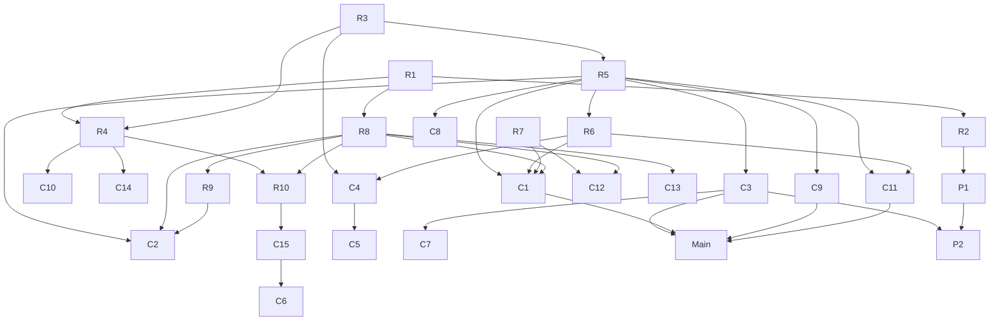
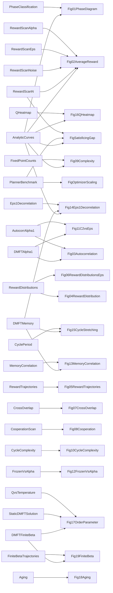

# 5. Dependencies

Two different dependency structures are tracked:

1. **Dependency of the arguments** (§5.1) — which claim of the paper rests on which result. This is the logical skeleton of the paper.
2. **Dependency of the classes** (§5.2–5.4) — which output class consumes which, as objects and morphisms of a category, exported to Catlab.jl.

## 5.1 Dependency of the arguments

Results (R) are mathematical or numerical facts; claims (C) are the paper's statements; P are the planner-study claims this repository adds.

| id | statement | rests on | evidence |
|---|---|---|---|
| R1 | $\upsilon=1-\varepsilon+\varepsilon^2/2$, $\eta=(1-\varepsilon)/\upsilon$ | definition (Eq. 8) | SymPy |
| R2 | $\mathcal R_N$ only sees $J^S$; planner = SK ground state; $\mathcal R_\infty=0.7632(2-\varepsilon)$ | R1, Parisi | SymPy, Eq. 13 |
| R3 | $\alpha\to0$: online ≈ offline up to $O(\sqrt{\alpha}/\beta)$; fixed points solve NMFE | EWMA bound | SymPy, App. A |
| R4 | $T_c(\varepsilon)=(2-\varepsilon)^2/(2\sqrt\upsilon)$ | R1, R3, elliptic law | SymPy (two routes) |
| R5 | $\Sigma(\eta)>0$ for $\eta>0$, $=0$ at $\varepsilon=1$; only $m=0$ for $\varepsilon>1$ | R3, Hwang et al. | Fig. 9, exact counts |
| R6 | $\Sigma_2=2\Sigma$ at $\alpha=1$; $\Sigma_2\to\Sigma$ as $\alpha\to0$ (no sharp transition) | R5, App. B | Fig. 10 |
| R7 | reaching time $\tau_r\sim N^se^{NB(\varepsilon)}$ ⇒ order of limits matters | Bastolla–Parisi | Fig. 11 |
| R8 | DMFT effective process (N→∞ first) | R1, cavity | Figs. 3, 11, 13, 14 |
| R9 | $\varepsilon=1,\alpha\to0$: $C=\frac2\pi\arcsin(\Delta/\Delta_0)$, $\tau_1=2.84$ | R8 | SymPy, Fig. 14 |
| R10 | static (RS) DMFT is unstable below $T_c$ | R8, R4 | Fig. 17b |
| C1 | learning does not converge in general (cycles, chaos) even in a static world | R5, R6, R7, R8 | Figs. 1, 3, 13 |
| C2 | competition (ε↑) destabilises fixed points → chaos → (ε>2−ε_c) quasi-cycles | R5, R6, R8, R9 | Figs. 1, 3, 6, 14 |
| C3 | when learning converges, $\mathcal R_N$ is ≈8% below $\mathcal R_\infty$ ("satisficing") | R2, R5 | Fig. 2 |
| C4 | long memory helps (cycles washed out, more fixed points reached) | R6, R3 | Figs. 2a, 10, 12, 13 |
| C5 | impatience (α→1) causes oscillations and lower reward ("bullwhip") | C4 | Fig. 2a |
| C6 | small noise *raises* $\mathcal R_N$ (annealing effect); large noise lowers it | R4, C15 | Fig. 2c |
| C7 | $\mathcal R_N\simeq\mathcal R_\infty^{\rm learn}-AN^{-2/3}$ | C3 | Fig. 2d |
| C8 | individual rewards are heterogeneous, $\rho(e)\sim\kappa e$ (marginal stability), negative tail for ε>0 | R5 | Figs. 4–6 |
| C9 | who wins is unpredictable (overlap → 0 with N; disorder chaos) | R5 | Fig. 7 |
| C10 | strong cooperation $J_0>1$ makes the game learnable | R4 (ferromagnetic shift) | Fig. 8 |
| C11 | exponentially many equilibria/cycles: no common knowledge | R5, R6 | Figs. 9, 10 |
| C12 | finite-N and N→∞ pictures differ (2-cycles persist at small N) | R7, R8 | Figs. 11, 13 |
| C13 | anomalous cycle stretching $L\sim\alpha^{-1/2}$ | R8 (Eq. 33, $\frac\alpha2\ddot Q$) | Fig. 15 |
| C14 | noise kills conviction above a line close to $T_c(\varepsilon)$ | R4 | Figs. 16, 17a, 19 |
| C15 | aging for ε<ε*≈0.47: quasi-equilibria last ∝ age | R10, R8 | Figs. 18, 19 |
| **Main** | the SK-game is *unlearnable*; agents must satisfice (H. Simon) | C1, C3, C9, C11 | — |
| P1 | the planner's optimum is reachable by heuristics only up to a solver-dependent size $N^\ast$ | R2 | FigOptimizerScaling |
| P2 | the gap learning-vs-planner persists as N grows | C3, C7, P1 | FigSatisficingGap |



## 5.2 Dependency of the classes, as a category

* **Objects** — the 48 output classes (`theory`, `data`, `table`, `benchmark`, `figure`) and the monoidal unit $I$.
* **Generating morphisms** — one per class: $\mathrm{make}_C : D_1\otimes\dots\otimes D_k\to C$ with $(D_i)=$ `C.depends_on` ($I$ if empty). Parameters are not objects: each generator is parametrised by its preset (a *Para* construction).
* **Category** — the free symmetric monoidal category on these generators. Every class $C$ has a canonical *derivation* $I\to C$:
  $$\mathrm{deriv}(C)=\mathrm{make}_C\circ\big(\mathrm{deriv}(D_1)\otimes\dots\otimes\mathrm{deriv}(D_k)\big).$$
  Example: $\mathrm{deriv}(\mathrm{Fig17})=\mathrm{make}_{\rm Fig17}\circ(\mathrm{make}_{\rm QvsTemperature}\otimes\mathrm{make}_{\rm StaticDMFTSolution}\otimes\mathrm{make}_{\rm DMFTFiniteBeta})$.
* **Math category** (`skgame/mathcat.py`) — objects $J,Q,m,S,C,\Sigma,\dots$, generators = elementary computations (`sample_J`, `learn`, `dmft_solve`, …). It contains endomorphisms (`learn : Q⊗R⊗Params → Q`), so it is not a DAG.
* **Uses relation** — a span $\mathrm{Out}\leftarrow\mathrm{Use}\rightarrow\mathrm{Mor}$ (a C-set) recording which elementary computations each output evaluates. Composing it with the downstream closure answers "if I change `dmft_solve`, which outputs are stale?" (`impacted_by`).

Invariants (checked in `tests/test_registry_category.py` and `julia/SKGameCategory/test/runtests.jl`): acyclic; every generator well typed; every derivation composes with domain $I$; every non-figure object feeds at least one figure; figures are terminal; every non-figure class is covered by the uses relation.

## 5.3 How it is kept in sync automatically

```
skgame/outputs/*.py  (classes with depends_on)      skgame/mathcat.py (objects, morphisms, uses)
            \______________________   ___________________________/
                                   v v
          python -m skgame category  →  category/category.json, category.dot, category.mmd,
                                        category/SKGamePaperLiteral.jl  (literal @present blocks)
                                   |
          julia --project=julia/SKGameCategory julia/run_category.jl
                    → Presentation(FreeSymmetricMonoidalCategory) ×2, DepGraph and Uses ACSets,
                      check_category, derivation, upstream/downstream, impacted_by, Graphviz
```
The Python pipeline uses the same graph for execution order and caching: each output's hash includes its parameters and the hashes of its inputs, so changing one class recomputes exactly its downstream closure.

## 5.4 Class dependency graph (generated)

<!-- BEGIN GENERATED -->

<!-- END GENERATED -->
