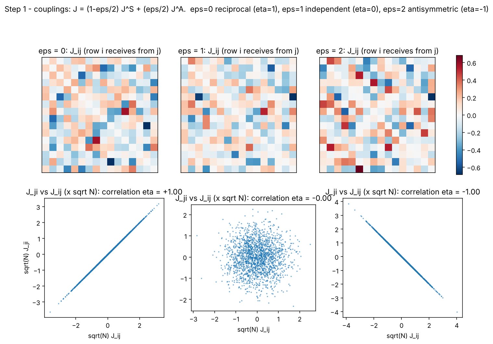
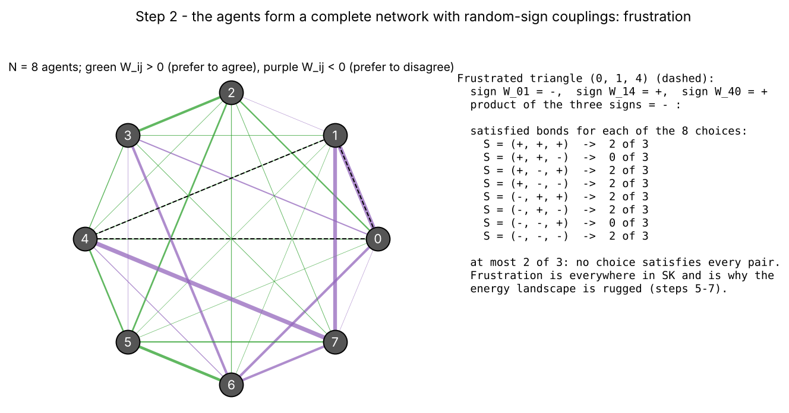
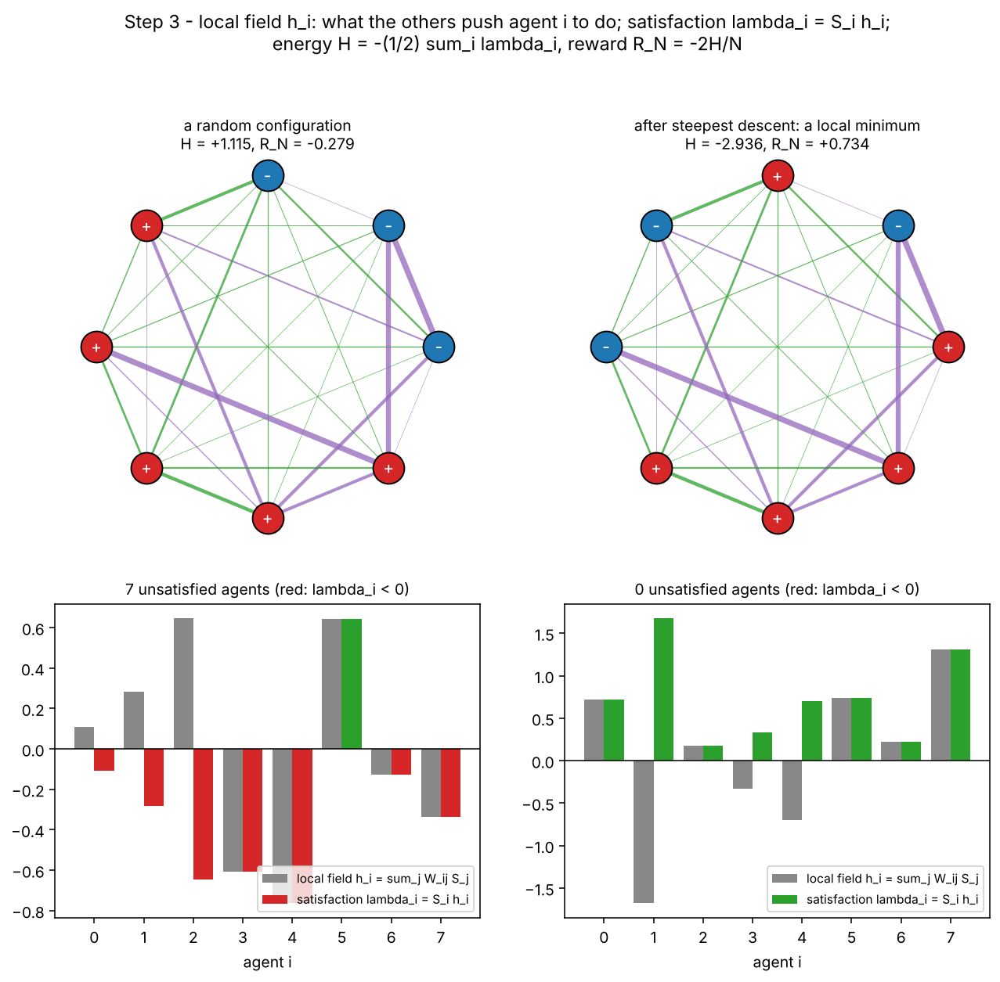
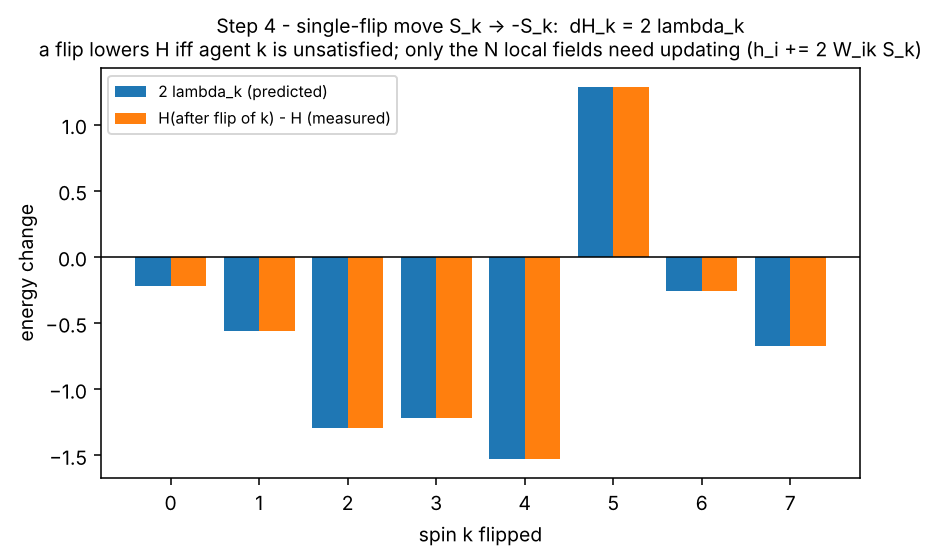
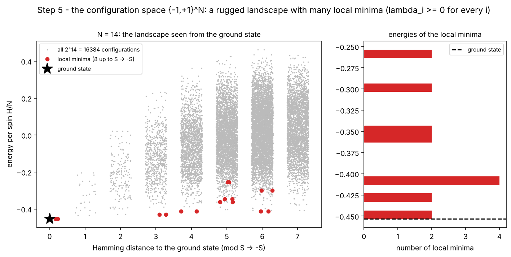
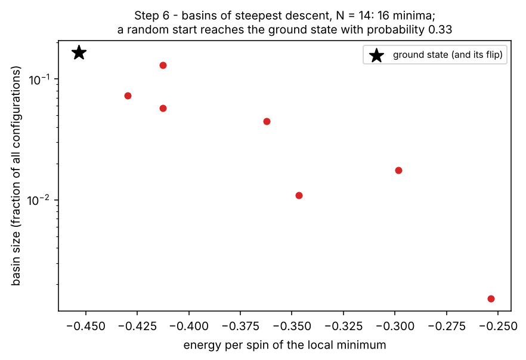
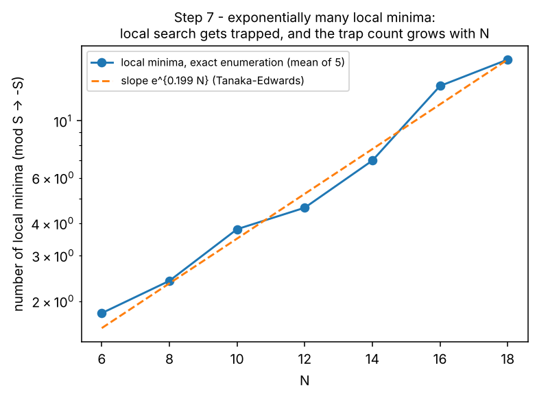
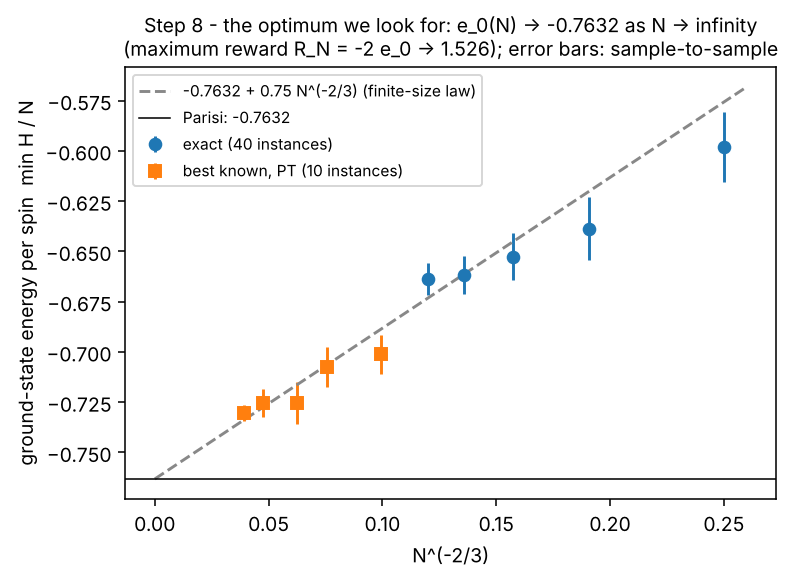
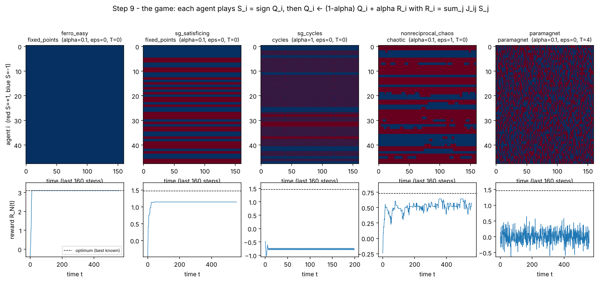
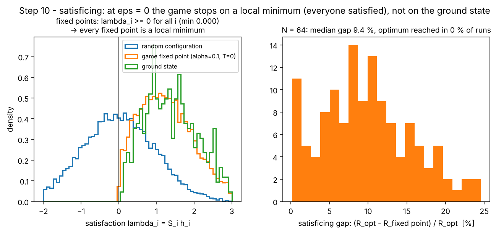

# The SK game, step by step

This page explains the model of Garnier-Brun, Benzaquen & Bouchaud (*Unlearnable games and "satisficing" decisions*, arXiv:2312.12252) and the optimisation problem hidden inside it. The words defined here, in **bold** and collected in the [Glossary](#glossary), are the ones used in [`../optimal_algorithms`](../optimal_algorithms/README.md) to explain what every optimisation algorithm does to an SK instance.

All figures are computed by `sk_game_explanation.py` from the model code in `../../unlearnable_games_explanation/skgame` (~1 min):
```bash
cd scripts/QuantumComputing/Dimod/src/visualization/SK_game
python sk_game_explanation.py            # or --steps 5 6
```

---

## Step 1: agents, decisions, couplings

There are $N$ **agents**. Each one takes a binary **decision**, its **spin** $S_i=\pm1$ (do / don't, buy / sell). What agent $i$ earns depends on everyone else through the **couplings** $J_{ij}$:

$$
R_i(S)=\sum_{j}J_{ij}S_j \qquad\text{(reward of agent } i\text{)}.
$$

The couplings are random:

$$
J=\Big(1-\frac{\varepsilon}{2}\Big)J^S+\frac{\varepsilon}{2}J^A+\frac{J_0}{N},\qquad J^S\text{ symmetric},\ J^A\text{ antisymmetric},\ \text{entries}\sim\mathcal N(0,1/N).
$$

The **non-reciprocity** $\varepsilon$ sets how much $J_{ji}$ resembles $J_{ij}$. Their correlation is $\eta=(1-\varepsilon)/(1-\varepsilon+\varepsilon^2/2)$, which gives:
* $\varepsilon=0$: reciprocal, $J_{ji}=J_{ij}$, $\eta=1$;
* $\varepsilon=1$: independent, $\eta=0$;
* $\varepsilon=2$: antisymmetric, what one wins the other loses, $\eta=-1$.

$J_0$ is a common cooperative bias.



The scatter plots measure $\eta$ on $N=400$: $+1.00$, $\approx0$, $-1.00$.

## Step 2: the network and frustration

Seen from the planner, only the symmetric part matters:

$$
W_{ij}=\tfrac12(J_{ij}+J_{ji}),\qquad W_{ii}=0 .
$$

$W_{ij}>0$ means $i$ and $j$ **prefer to agree** (green), $W_{ij}<0$ that they **prefer to disagree** (purple). Every agent is connected to every other one: the network is **complete**.



A triangle whose three couplings have a negative product is **frustrated**: no choice of the three decisions satisfies all three pairs. The figure enumerates the 8 choices and finds at most 2 of 3. In SK about half of all triangles are frustrated. This is the root of everything that makes the problem hard.

## Step 3: local field, satisfaction, energy, reward

For a **configuration** $S=(S_1,\dots,S_N)$:

* the **local field** on agent $i$: $\;h_i=\sum_jW_{ij}S_j$. It is what the others push $i$ to do;
* the **satisfaction** of agent $i$: $\;\lambda_i=S_ih_i$. When $\lambda_i>0$, $i$ goes along with its field and is **satisfied**; when $\lambda_i<0$ it is **unsatisfied**;
* the **energy**: $\;H(S)=-\sum_{i<j}W_{ij}S_iS_j=-\tfrac12\sum_i\lambda_i$;
* the **average reward**: $\;R_N(S)=\frac1N\sum_iS_iR_i=\frac1NS^\top JS=\frac1NS^\top WS=-\frac{2H}{N}$.

The last chain of equalities holds because $S^\top JS$ only sees the symmetric part of $J$, and the diagonal is zero. **Maximising the average reward is minimising the energy**: this is the planner's problem, and it is the SK spin glass.



Left: a random configuration, with several unsatisfied agents (red bars). Right: the same instance after repeatedly flipping the most unsatisfied agent. Everyone is now satisfied, and the energy is lower.

## Step 4: the single-flip move

The elementary move of almost every algorithm is the **single flip** $S_k\to-S_k$. Only the terms containing $k$ change sign, so

$$
\Delta H_k=H(S\text{ with }S_k\text{ flipped})-H(S)=2\sum_jW_{kj}S_kS_j=2\lambda_k .
$$

A flip **lowers the energy if and only if agent $k$ is unsatisfied**. After the flip the local fields are updated in $O(N)$:

$$
h_i\leftarrow h_i-2W_{ik}S_k^{\rm old}=h_i+2W_{ik}S_k^{\rm new}.
$$



The prediction $2\lambda_k$ and the measured energy difference coincide for every $k$.

## Step 5: the landscape

There are $2^N$ configurations (vertices of a hypercube). Two configurations are **neighbours** if they differ by one flip. Their distance is the **Hamming distance** (number of different spins). $S$ and $-S$ have the same energy (**global flip symmetry**), so everything is counted modulo it.

* A **local minimum** (also called a **metastable state**, or a **1-flip-stable state**) is a configuration that no single flip can improve: $\lambda_i\ge0$ for every $i$. **Everyone is satisfied, but the configuration is not necessarily the best one.**
* The **ground state** is the global minimum of $H$, i.e. the maximum of $R_N$: the optimum we want.



For $N=14$, all $2^{14}=16\,384$ configurations: grey dots, energy against distance from the ground state. Red: the 8 local minima (16 counting the flip-symmetric copies). Some are close to the ground state in energy, $-0.43$ vs $-0.45$, but **far in configuration space** (3 to 6 flips away): to go from one to the other you have to cross configurations of higher energy, an **energy barrier**.

## Step 6: basins

Start from any configuration and keep flipping the most unsatisfied agent (**steepest descent**). You end in one local minimum: its **basin of attraction**.



For $N=14$ the ground state's basin holds about 33 % of all configurations, so a random start reaches the optimum with probability about 0.33. The other minima collect the rest. Deeper minima tend to have larger basins, but this is not a rule.

## Step 7: exponentially many traps



The number of local minima, counted exactly by enumeration (mean of 5 instances per $N$), grows like $e^{\Sigma N}$ with the **complexity** $\Sigma\approx0.199$ (Tanaka–Edwards). Since the basin of the ground state is one among exponentially many, the probability that a random start falls into it **decays exponentially with $N$**. This is the core difficulty that every algorithm in `../optimal_algorithms` addresses in its own way: by noise (**temperature**), by **replicas**, by **memory**, by **relaxation**, or by **quantum tunnelling**.

## Step 8: what the optimum looks like



The ground-state energy per spin tends to the Parisi value $e_0=\lim H_{\min}/N=-0.7632$, with finite-size corrections $\approx0.75\,N^{-2/3}$. In reward units, $R_N^\star\to-2e_0=1.526$; for general $\varepsilon$, $R_\infty=0.7632\,(2-\varepsilon)$, since $W=(1-\varepsilon/2)J^S$. Up to $N=24$ the points are exact (Gray-code enumeration); beyond, they are the best value found by long parallel tempering runs, so only **best known**.

## Step 9: the game, i.e. how the agents learn

The agents do not solve the optimisation problem: they **learn**. Each agent keeps an **incentive** $Q_i$, a memory of past rewards, and plays according to it:

$$
S_i(t)=\operatorname{sign}Q_i(t)\ \ (\text{at }T=0;\ \text{at temperature }T=1/\beta:\ P[S_i=\pm1]=\tfrac12(1\pm\tanh\beta Q_i)),
$$
$$
Q_i(t+1)=(1-\alpha)\,Q_i(t)+\alpha\,R_i(t),\qquad R_i(t)=\sum_jJ_{ij}S_j(t).
$$

$\alpha$ is the **memory-loss rate**: the memory lasts about $1/\alpha$ steps. The five regimes used in the campaign (`skgame/optim/regimes.py`) show the four **phases**:



| regime | parameters | phase | what happens |
|---|---|---|---|
| `ferro_easy` | $J_0=3$ | fixed point | everyone aligns: the reward reaches the optimum |
| `sg_satisficing` | $\varepsilon=0,\ \alpha=0.1$ | **fixed point** | the decisions freeze; the reward stays below the optimum |
| `sg_cycles` | $\alpha=1$ | **2-cycle** | no memory: everyone over-reacts and flips back and forth |
| `nonreciprocal_chaos` | $\varepsilon=1$ | **chaos** | without reciprocity, decisions keep changing irregularly |
| `paramagnet` | $T=4>T_c=2$ | **paramagnet** | too much noise: random play, reward ≈ 0 |

The full phase diagram in $(\varepsilon,\alpha)$ is in `../../unlearnable_games_explanation/output/figure/Fig01PhaseDiagram/fig01_phase_diagram.png`.

## Step 10: satisficing, and why the game is itself an optimiser (a weak one)

At a fixed point of the $T=0$ dynamics, $Q_i=R_i$ and $S_i=\operatorname{sign}Q_i=\operatorname{sign}R_i$. Therefore $S_iR_i\ge0$ for every $i$. At $\varepsilon=0$ we have $R_i=h_i$, so $\lambda_i\ge0$ for all $i$: **every fixed point of the game is a local minimum of $H$**.



Left: the satisfaction of all agents at the fixed points reached by the game ($N=64$, 8 instances × 16 starts) is never negative (minimum 0.000), exactly like at a local minimum. A random configuration has about half of the agents unsatisfied. Right: the price, called the **satisficing gap**, is the relative distance from the optimum. Its median is 9.4 %, and the optimum was reached in 0 of 128 runs.

So the game is a **local search with memory**. It is very good at making everyone satisfied and blind to the global optimum. The algorithms in `../optimal_algorithms` are, one by one, the ways out of this trap.

---

## Glossary

| term | symbol | meaning |
|---|---|---|
| agent / spin / decision | $S_i=\pm1$ | the binary choice of agent $i$ |
| configuration | $S\in\{-1,1\}^N$ | all the decisions together; $2^N$ of them |
| coupling | $J_{ij}$ | effect of $j$'s decision on $i$'s reward (game) |
| symmetric coupling | $W_{ij}=\frac12(J_{ij}+J_{ji})$ | what the planner's problem sees; zero diagonal |
| non-reciprocity | $\varepsilon$ | $0$ symmetric, $1$ independent, $2$ antisymmetric |
| cooperative bias | $J_0$ | mean coupling; $J_0/(1-\varepsilon/2)>1$ makes the problem ferromagnetic and easy |
| frustration | | a loop of couplings whose signs cannot all be satisfied |
| local field | $h_i=\sum_jW_{ij}S_j$ | the pull of the others on $i$ |
| satisfaction | $\lambda_i=S_ih_i$ | $>0$ satisfied, $<0$ unsatisfied |
| energy | $H=-\sum_{i<j}W_{ij}S_iS_j=-\frac12\sum_i\lambda_i$ | to be minimised |
| average reward | $R_N=\frac1NS^\top JS=-2H/N$ | to be maximised; the same problem |
| single-flip move | $S_k\to-S_k$, $\Delta H_k=2\lambda_k$ | the elementary step of local algorithms |
| neighbour, Hamming distance | | configurations one flip apart; number of differing spins |
| local minimum (metastable, 1-flip stable) | $\lambda_i\ge0\ \forall i$ | no single flip helps; a **fixed point** of the $T=0$ game at $\varepsilon=0$ |
| ground state, optimum | $\min H=\max R_N$ | what we want; $H/N\to-0.7632$ |
| basin of attraction | | configurations that steepest descent sends to a given minimum |
| energy barrier | | the energy rise needed to go from one minimum to another |
| complexity | $\Sigma\approx0.199$ | number of local minima $\sim e^{\Sigma N}$ |
| temperature, noise | $T=1/\beta$ | how often an energy-raising move is accepted / how random play is |
| incentive, memory | $Q_i$, $\alpha$ | the agent's running estimate of its reward; memory time $\sim1/\alpha$ |
| phase | | fixed point, cycle, chaos, paramagnet: long-time behaviour of the game |
| satisficing gap | $(R^\star-R)/R^\star$ | distance of a satisfied state from the optimum |
| reference / best known | $R_{\rm ref}$ | exact optimum ($N\le24$) or best value found by any method |
