# How the SK problem is embedded on Zephyr and Pegasus

The planner's problem is the SK energy $H(S)=-\sum_{i<j}W_{ij}S_iS_j$ on $N$ spins. Every spin interacts with every other one: the **problem graph is the complete graph $K_N$**. A D-Wave QPU only has couplers between neighbouring qubits, so each logical spin $S_i$ has to be represented by a **chain** $C_i$ of physical qubits. This folder explains, figure by figure, how the all-to-all (*clique*) embedding used in this project builds those chains on **Zephyr** (Advantage2) and **Pegasus** (Advantage).

Every figure is computed from the real graphs (`dwave.graphs`) and the real embeddings (`minorminer.busclique`, the algorithm behind `DWaveCliqueSampler` and the `clique` strategy of `skgame/optim/embedding.py`). Regenerate them with:

```bash
cd scripts/QuantumComputing/Dimod/src/visualization/embedding_explanation
python embedding_explanation.py                 # ~30 s, figures/*.png + 2 GIFs
python embedding_explanation.py --heuristic     # + minorminer comparison in step 9 (~3 min)
python embedding_explanation.py --steps 7 8     # only some steps
```
The heavier companion, [chains_and_tuning.md](chains_and_tuning.md), explains what chains do to the energy scale and how to tune the QPU (chain strength, chain-break resolution, annealing time, etc.) to get better solutions.

---

## Step 1: the problem is a complete graph

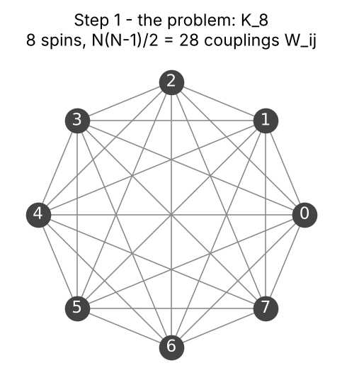

$N$ spins and $N(N-1)/2$ couplings $W_{ij}$: for $N=160$ that is $160\cdot159/2=12\,720$ couplings. The hardware has nowhere near that many couplers per qubit, so we need to "spread" each spin over several qubits.

## Step 2: the hardware graphs

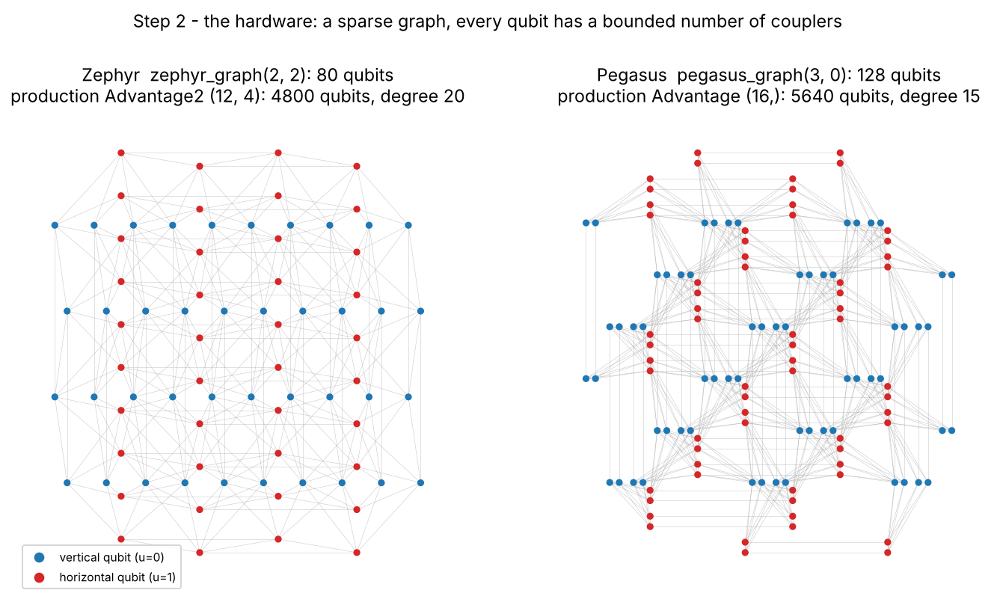

Both topologies are made of **qubits of two orientations**: vertical (blue, $u=0$) and horizontal (red, $u=1$). Physically each qubit is a long superconducting loop: a vertical one crosses many horizontal ones, and the crossings are where the couplers sit.

| | Zephyr $Z(12,4)$ (Advantage2) | Pegasus $P_{16}$ (Advantage) |
|---|---|---|
| nominal qubits | $4t\,m(2m+1)=4\cdot4\cdot12\cdot25=4800$ | $24m(m-1)=24\cdot16\cdot15=5760$ minus the boundary, $5640$ |
| couplers per qubit (bulk) | **20** | **15** |
| coordinates of a qubit | $(u,w,k,j,z)$ | $(u,w,k,z)$ |

In the coordinates, $u$ is the orientation, $z$ the position along the qubit's line, and the other indices say which line the qubit belongs to.

## Step 3: three kinds of couplers

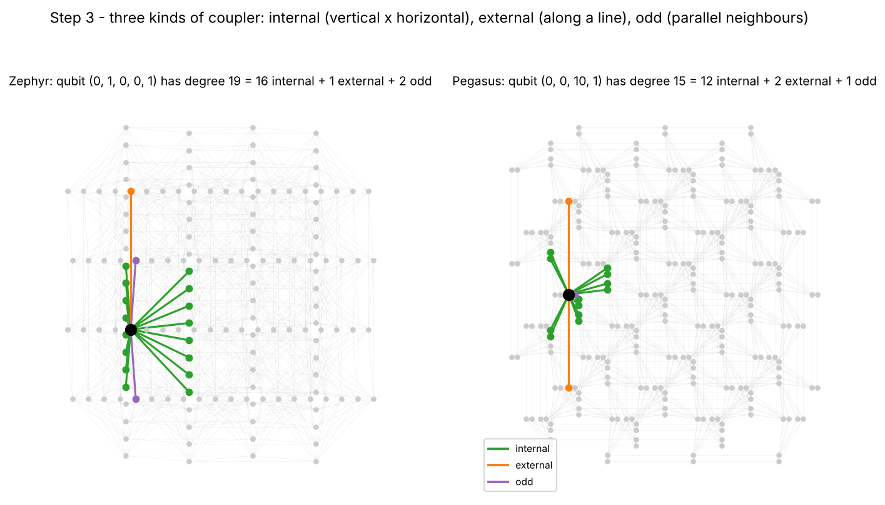

For the black qubit, its neighbours are coloured by the coupler that reaches them. The counts are computed from the production graphs:

* **internal** (green): to qubits of the *other* orientation that it crosses. Zephyr has 16 of these, Pegasus 12;
* **external** (orange): to the previous and next qubit *on the same line*, 2 in both topologies;
* **odd** (purple): to a parallel neighbouring qubit. Zephyr has 2, Pegasus 1.

That gives degree $16+2+2=20$ for Zephyr and $12+2+1=15$ for Pegasus. The internal couplers are what makes cliques possible; the external couplers make long chains possible.

## Step 4: lines

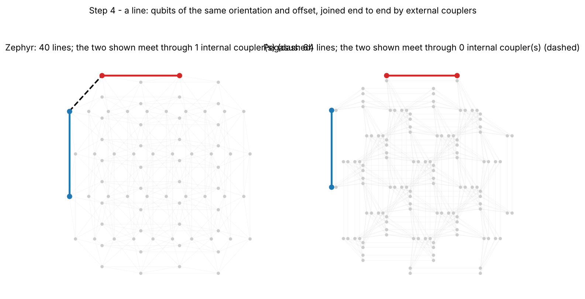

Qubits with the same orientation and the same line index, joined end to end by **external couplers**, form a **line**. A segment of a line is the natural building block of a chain: it is connected, and it crosses many lines of the other orientation. The dashed couplers are where the vertical line shown meets the horizontal line shown.

## Step 5: a chain = one vertical segment + one horizontal segment

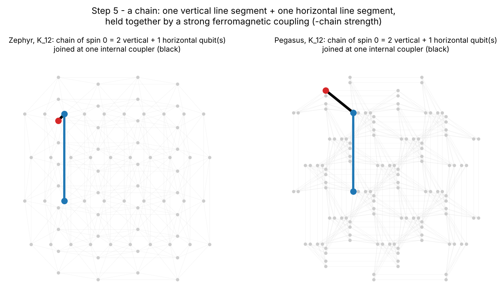

The clique embedding gives spin $i$ the chain

$$C_i = V_i \cup H_i,\qquad V_i=\text{a vertical line segment},\quad H_i=\text{a horizontal line segment},$$

joined by **one internal coupler**, the *corner* (black). I checked this for every chain at production size ($N=160$, see the script's `split_chain`): on both topologies all 160 chains are exactly one contiguous vertical segment plus one contiguous horizontal segment, and each uses exactly one cross-orientation coupler internally. On the QPU, every coupler inside a chain is set to $-c$ (the **chain strength**), so the qubits of $C_i$ prefer to agree, and their common value is read as $S_i$.

## Step 6: all chains

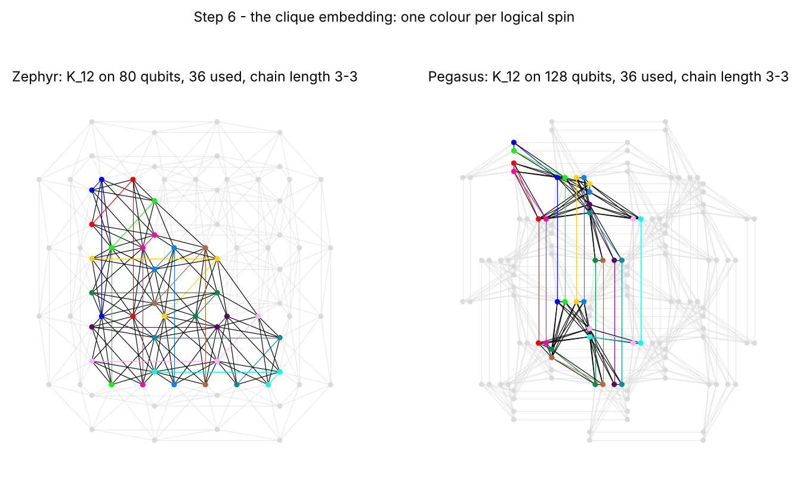

One colour per logical spin. On these small graphs $K_{12}$ takes 3-qubit chains on both. At production size the chains get longer (step 9).

The animations add the chains one at a time; the dotted lines are the couplers that link the new chain to the chains already placed:

| Zephyr | Pegasus |
|---|---|
| 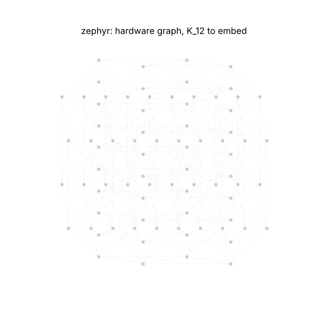 | 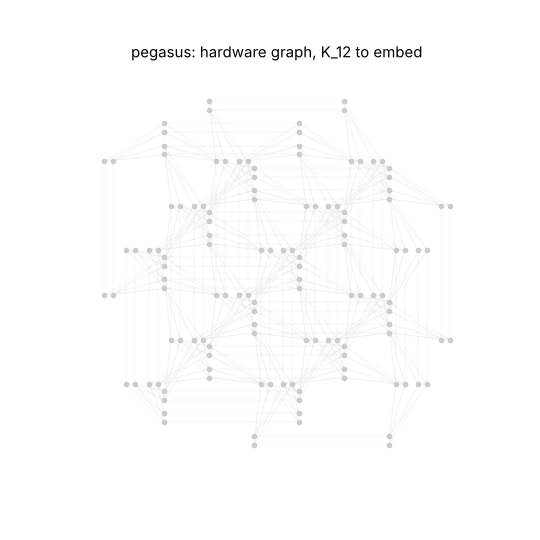 |

## Step 7: why every pair of spins gets a coupler

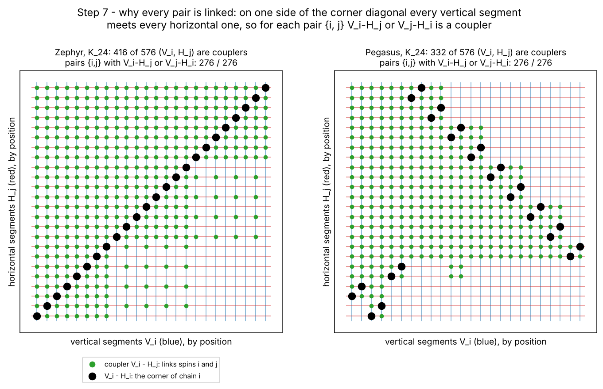

The columns are the vertical segments $V_i$, the rows the horizontal segments $H_j$, both sorted by their position on the chip. A green dot means "there is an internal coupler between $V_i$ and $H_j$". That coupler can carry $W_{ij}$, because $V_i\subset C_i$ and $H_j\subset C_j$. The black dots are the corners ($i=j$).

The corners form a staircase. **On one side of the staircase every vertical segment meets every horizontal one**: the segments are long enough to cross all the lines of the block. For any pair $\{i,j\}$, at least one of $V_i$–$H_j$ or $V_j$–$H_i$ is therefore a coupler. The figure counts it: 276 of 276 pairs for $K_{24}$ on both topologies. That is the whole trick of the native clique embedding: the $N(N-1)/2$ couplings are placed on the crossings of $N$ vertical and $N$ horizontal segments.

## Step 8: check on the whole problem

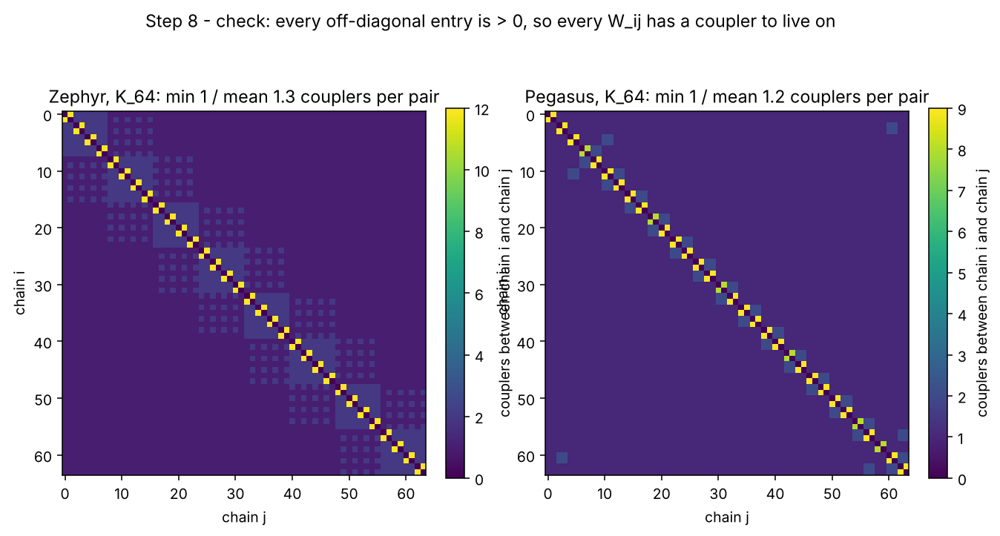

Number of couplers between chain $i$ and chain $j$ for $K_{64}$, counting all coupler kinds. Every off-diagonal entry is $\ge1$, so the embedding is valid (also checked by `is_valid_embedding`). When a pair has several couplers, `embed_bqm` splits $W_{ij}$ evenly among them (on average about 1.2 couplers per pair on Zephyr and 1.1 on Pegasus at $N=160$).

## Step 9: what all-to-all costs, Zephyr vs Pegasus

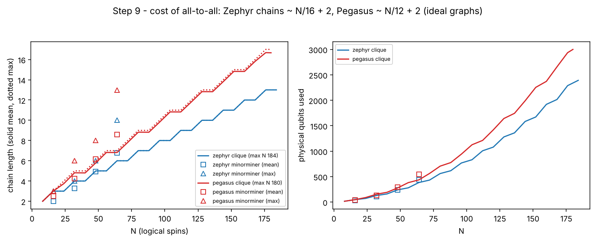

On the ideal (defect-free) graphs:

| N | Zephyr chain length | Zephyr qubits | Pegasus chain length (mean / max) | Pegasus qubits |
|---|---|---|---|---|
| 32 | 4 | 128 | 4.8 / 5 | 154 |
| 64 | 6 | 384 | 6.8 / 7 | 436 |
| 128 | 10 | 1280 | 12.8 / 13 | 1642 |
| 160 | 12 | 1920 | 14.8 / 15 | 2372 |
| largest | **184** (length 13) | 2392 | **180** (length 17) | 3000 |

Zephyr chains grow like about $N/16+2$, for example $160/16+2=10+2=12$. Pegasus chains grow like about $N/12+2$, for example $160/12+2\approx13.3+2\approx15$. The reason is the higher internal degree: each Zephyr segment crosses more segments per qubit. **Shorter chains mean fewer chain breaks and less loss of energy resolution** ([chains_and_tuning.md](chains_and_tuning.md)), so on embedding grounds alone Zephyr should win. Whether it actually wins on the QPU is what the `qpu:zephyr:clique` vs `qpu:pegasus:clique` comparison in `main_simulation.py` measures.

The hollow markers are the general-purpose heuristic (minorminer, best of 2 tries). For $K_N$ it gives **longer and uneven** chains (the max is much larger than the mean) and it takes minutes instead of milliseconds, which is why the clique embedding is the default.

## Step 10: real chips have dead qubits

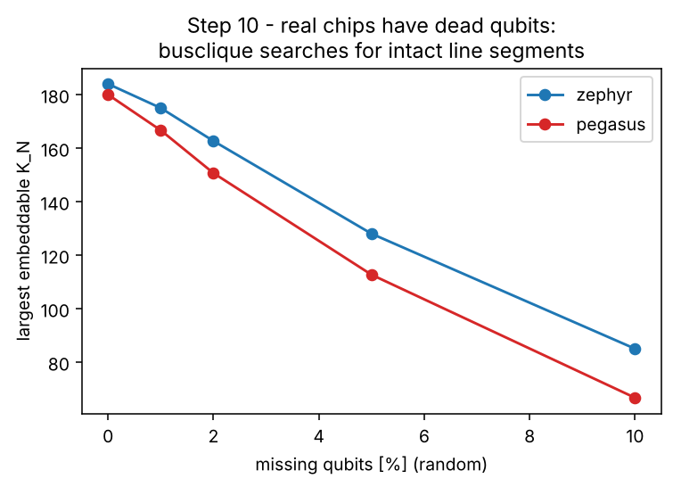

Real QPUs have a few percent of inoperable qubits and couplers. A chain is only usable if all of its qubits and the external couplers between them work, so **busclique only uses intact segments** and searches for the arrangement that still gives the largest clique. With random defects the largest clique drops quickly: from 184 to about 163 on Zephyr and from 180 to about 151 on Pegasus, at 2 % missing qubits. Zephyr keeps its lead. On the real solver, `python main_simulation.py qpu --check` prints the true largest $N$, and the campaign skips larger $N$ automatically.

---

## The algorithms, step by step

### Clique embedding (`minorminer.busclique`), the one used here

This follows Boothby, King & Raymond, *Fast clique minor generation in Chimera qubit connectivity graphs* (Quantum Inf. Process. 15, 495, 2016), generalised in minorminer to Pegasus and Zephyr. Figures 4–8 above show the result of each stage on the real graphs.

1. **Lines.** Group the qubits into lines: same orientation and line index, consecutive $z$, joined by external couplers (step 4).
2. **Intact segments ("buses").** For every line and every interval $[z_0,z_1]$, record whether all qubits and the external couplers between them work. Only intact segments can be part of a chain (step 10).
3. **A block and its staircase.** Choose a rectangular block of the chip. Inside it, $N$ vertical segments and $N$ horizontal segments are chosen so that each vertical segment $V_i$ is paired with a horizontal segment $H_i$ that it crosses (the corner). The pairs are laid out along a staircase so that, on one side, all verticals meet all horizontals (step 7).
4. **Chains.** $C_i=V_i\cup H_i$. Every pair $\{i,j\}$ is linked by the $V_i$–$H_j$ or $V_j$–$H_i$ coupler (steps 5–8).
5. **Optimisation over placements.** Steps 3–4 are repeated over block positions, sizes and corner arrangements with dynamic programming. The goal is the **largest $N$**, and among equal $N$ the **shortest maximum chain length**, using only intact segments. The cost is polynomial in the chip size, so for a whole QPU it takes seconds.
6. **Cache.** Results are cached per hardware graph (`use_cache=True`). This project also stores each embedding in `embeddings/<graph>/<strategy>/N….json` (`EmbeddingCache`), so every job and every machine uses the same chains.

Clique chains all have (almost) the same length, which keeps the chain strength uniform and the quantum dynamics of different chains in step.

### Heuristic embedding (`minorminer.find_embedding`), the baseline

This is Cai, Macready & Roy, *A practical heuristic for finding graph minors* (arXiv:1406.2741, 2014). It works for any problem graph, not only $K_N$.

1. **Initial placement.** Place the chain of each logical variable (spin) one after another, temporarily allowing qubits to be shared by several chains.
2. **Re-route one chain.** Remove chain $C_i$ and rebuild it as a tree rooted at the qubit that minimises the total *weighted* shortest-path distance to all the chains of its neighbours $j$ (in $K_N$, all other spins). A qubit already used by $k$ other chains costs about $\alpha^k$ (exponential penalty), so overlaps get expensive.
3. **Repeat** over all variables, increasing the penalty, until no qubit is shared: that is a valid embedding.
4. **Improvement rounds.** Keep re-routing to reduce the maximum chain length and the total number of qubits. `HeuristicEmbedding` additionally keeps the best of several random seeds.

On a complete graph this is slower and gives longer, uneven chains (step 9), so it is kept only as a reference (`qpu:zephyr:minorminer`).
