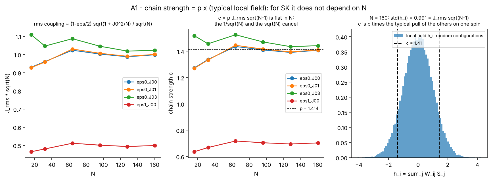
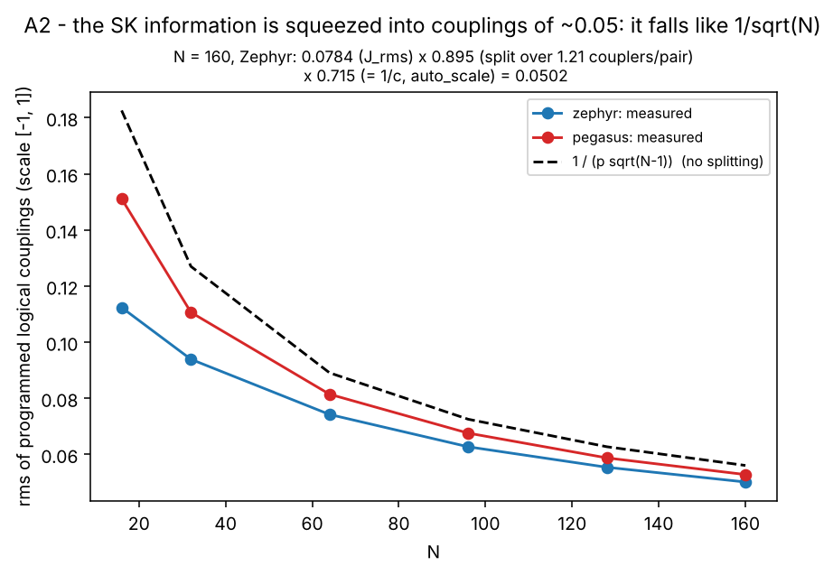
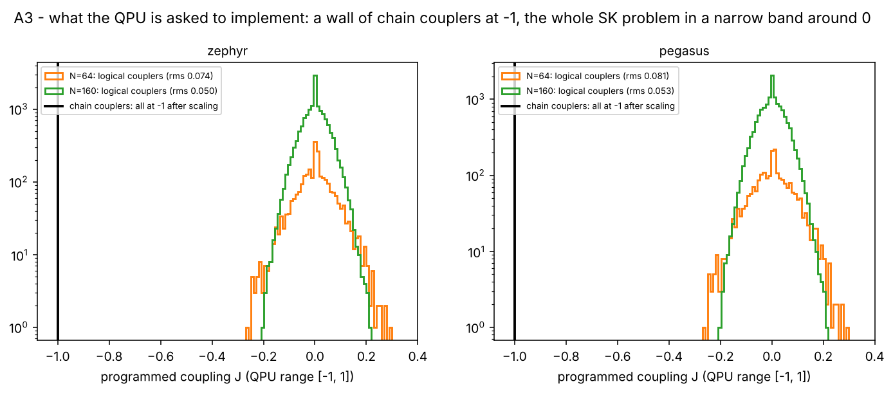
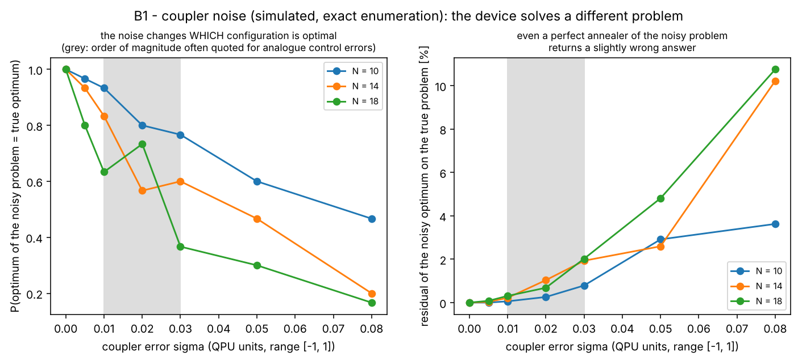
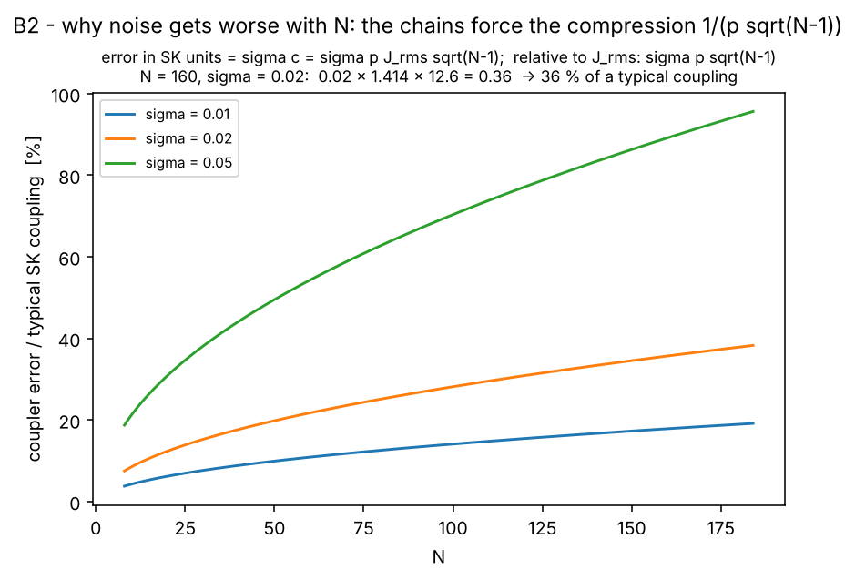
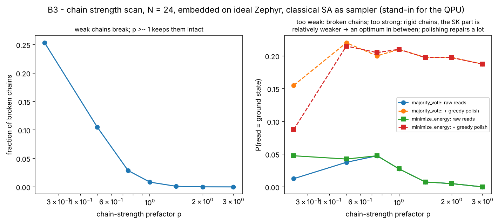
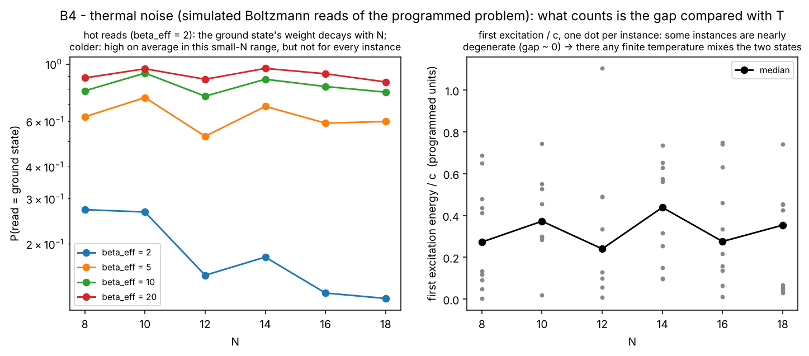
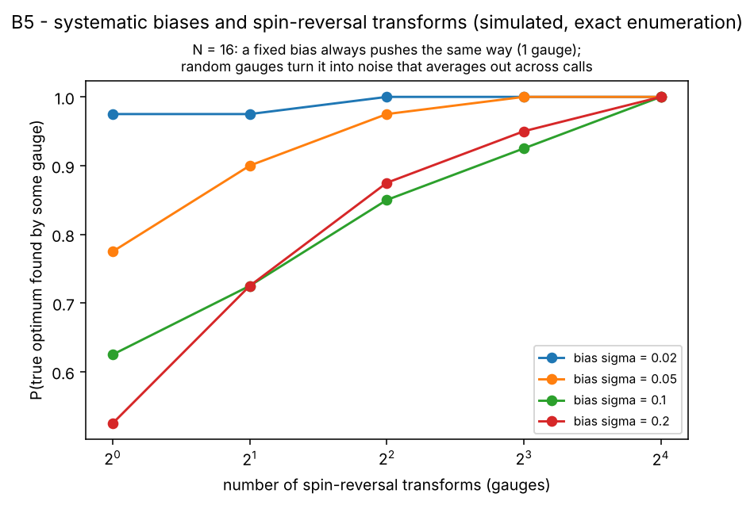

# Chain strength, energy compression and noise: how I got there

This document reconstructs, step by step, how I established three statements used throughout the project:

1. the default chain strength is $c=p\,J_{\rm rms}\sqrt{\bar d}$;
2. for SK it is $c\approx p\approx1.4$ at every $N$;
3. after the QPU's automatic scaling, the SK couplings live at about $0.05$ on a scale of $1$.

It then explains what this implies for **noise**, with simulated experiments. Every number below is reproduced by `noise_and_chains.py` (~4 min):

```bash
cd scripts/QuantumComputing/Dimod/src/visualization/noise_and_chains
python noise_and_chains.py              # or --steps A1 B3
```

**What is measured and what is modelled.** Part A is measured on real SK instances, with the real D-Wave library functions and real embeddings. Part B is **simulation**: no QPU was used in this project yet, because there was no token in the development environment. Each B figure states its model. The models are deliberately simple, chosen to isolate one mechanism at a time. They show *what kind* of problem each noise source causes and *which way* each mitigation pushes. They do not predict the QPU's numbers.

---

## Part A: from the library source to 0.05

### Step 1: the question

An SK instance needs chains (see `../embedding_explanation`). Inside a chain the couplers are set to $-c$. How large is $c$ by default, and what does it do to the rest of the problem? The campaign uses `FixedEmbeddingComposite` with `chain_strength = partial(uniform_torque_compensation, prefactor=p)`, so the answer is in that function.

### Step 2: read the function

`inspect.getsource(dwave.embedding.chain_strength.uniform_torque_compensation)` shows, stripped of comments:

```python
num_interactions = bqm.num_interactions
rms = sqrt(sum(J**2 for J in bqm.quadratic.values()) / num_interactions)
avg_degree = bqm.degrees(array=True).mean()
return prefactor * rms * sqrt(avg_degree)          # prefactor = 1.414 by default
```

So
$$c=p\cdot J_{\rm rms}\cdot\sqrt{\bar d}.$$

The docstring gives the reason. A chain cut in two halves receives from its neighbouring chains a random "torque", a sum of many couplings with random signs. By the central limit theorem its typical size is $\propto J_{\rm rms}\sqrt{\bar d}$, and the chain coupling has to exceed it.

### Step 3: evaluate the two factors for SK

* The planner's couplings are $W_{ij}=\tfrac12(J_{ij}+J_{ji})$ with $J^S_{ij}\sim\mathcal N(0,1/N)$, so $W_{ij}=(1-\varepsilon/2)J^S_{ij}+J_0/N$. For $\varepsilon=0$, $J_0=0$: $J_{\rm rms}=1/\sqrt N$.
* The problem graph is complete, so $\bar d=N-1$.

Therefore
$$c=p\cdot\frac{1}{\sqrt N}\cdot\sqrt{N-1}=p\sqrt{1-\tfrac1N}\ \xrightarrow{N\to\infty}\ p .$$



Left: $J_{\rm rms}\sqrt N\to1$. It equals $(1-\varepsilon/2)$ for $\varepsilon=1$ (red, 0.5); $J_0=3$ adds $J_0^2/N$ (green, slightly above 1). Middle: $c$ computed **by the library itself**, flat in $N$, about 1.4 (and 0.7 at $\varepsilon=1$). The script checks that my formula and the library agree to machine precision (an `assert` in `A1`).

### Step 4: what $c$ means physically

$c/p=J_{\rm rms}\sqrt{N-1}$ is exactly the standard deviation of a **local field** $h_i=\sum_jW_{ij}S_j$ for a random configuration: a sum of $N-1$ terms of variance $J_{\rm rms}^2$. Right panel: for $N=160$, std$(h_i)=0.991$. So **the chain strength is $p$ times the typical pull of the other agents on one agent**. That is the intuitive meaning: a chain must hold together against the pull that the SK problem exerts on its spin.

### Step 5: what embedding does to $W_{ij}$

`embed_bqm` (inside the composite) puts $W_{ij}$ on the hardware couplers between chain $C_i$ and chain $C_j$. When there are $|E_{ij}|>1$ of them, it **divides $W_{ij}$ evenly** among them, so each physical logical coupler carries $W_{ij}/|E_{ij}|$. I measured the averages on the clique embeddings at $N=160$: $|E_{ij}|=1.21$ on Zephyr and $1.11$ on Pegasus. The rms of the physical logical couplers is therefore a little smaller than $J_{\rm rms}$: $0.0702$ instead of $0.0784$ on Zephyr, a factor $0.895$.

### Step 6: what auto-scaling does

The QPU accepts couplings in $[-1,1]$. With `auto_scale` the whole programmed Hamiltonian is divided by its largest coefficient. The chain couplers ($|{-c}|=1.398$) are much larger than any logical coupler ($\max|W_{ij}|=0.29$ at $N=160$), so the factor is set by the chains:
$$\lambda=\frac1c=\frac{1}{1.398}=0.715 .$$

### Step 7: multiply

For $N=160$ on Zephyr:
$$\underbrace{0.0784}_{J_{\rm rms}}\times\underbrace{0.895}_{\text{split}}\times\underbrace{0.715}_{1/c}=0.0702\times0.715=0.0502 .$$
Ignoring the split, the general law is
$$\text{rms of programmed SK couplings}\approx\frac{J_{\rm rms}}{c}=\frac{1}{p\sqrt{N-1}},\qquad N=160:\ \frac{1}{1.414\times12.61}=\frac{1}{17.83}=0.056 .$$



Measured on both topologies against $1/(p\sqrt{N-1})$. Pegasus is slightly higher only because it splits less ($1.11$ vs $1.21$ couplers per pair). Note that **$J_0$ and $\varepsilon$ cancel out of the compression**: they rescale $J_{\rm rms}$ and $c$ by the same factor.



What the QPU actually receives: every chain coupler at exactly $-1$, and the entire SK instance in a narrow band around $0$ (rms 0.074 at $N=64$, 0.050 at $N=160$ on Zephyr).

---

## Part B: what noise does, and what reduces it

A physical annealer adds errors on top of the ideal dynamics. Four kinds matter here.

### B1: random errors on the programmed couplings

**Model.** Every coupler gets an independent error $\delta\sim\mathcal N(0,\sigma)$ in QPU units. Back in SK units this is $\sigma c$ added to each $W_{ij}$, because of the $1/c$ scaling. The ideal annealer then solves the **noisy** problem exactly, which I computed by exact enumeration for $N=10,14,18$, 30 instances each.



**What it produces.** The noisy problem has a **different optimum**. At $\sigma=0.03$ the true optimum is still the optimum of the noisy problem in only 77 % ($N=10$), 60 % ($N=14$) and 37 % ($N=18$) of the instances. Even a perfect annealer then returns a configuration 1–2 % above the true minimum.

**The problem it raises.** It is invisible from inside: every read is consistent, but with the wrong problem. Repeating the same call does not help. This is a bias of the call, not a random error of the read.

### B2: why it gets worse with $N$

Compared with a typical SK coupling ($J_{\rm rms}$), the error is

$$\frac{\sigma c}{J_{\rm rms}}=\frac{\sigma\,p\,J_{\rm rms}\sqrt{N-1}}{J_{\rm rms}}=\sigma\,p\sqrt{N-1}.$$

For $N=160$ and $\sigma=0.02$: $0.02\times1.414\times12.61=0.357$, i.e. **36 % of a typical coupling**.



This is the most important consequence of the chains for SK. The compression $1/(p\sqrt{N-1})$ of Part A turns a fixed analogue error into a relative error that grows like $\sqrt N$, at exactly the sizes where SK's energy gaps shrink.

### B3: chain breaks and the chain strength trade-off

**Model.** The real embedded problem (clique embedding on the ideal Zephyr graph, chains, the library's chain strength and chain-break resolution), with classical SA (200 sweeps, 100 reads, 4 instances, $N=24$) standing in for the QPU. This shows the classical side of chains (breaking, rigidity), not quantum effects.



**What it produces.** Weak chains break: 25 % of chains at $p=0.25$, 10 % at $0.5$, below 1 % from $p\ge1$. Strong chains do not break, but the raw success drops from about 0.05 at $p=0.5$–$0.75$ to 0 at $p=3$: rigid chains make single-spin moves expensive, and the SK part becomes relatively weak. The optimum lies in between, below the default 1.414 in this classical proxy. **Polishing** each read with greedy descent raises the success from ≤ 0.05 to about 0.2 at every $p\ge0.5$. Resolving broken chains by `minimize_energy` instead of `majority_vote` helps the raw reads only where chains break.

**The problem it raises.** Two opposite failure modes, and the best $p$ depends on the instance and on $N$. The default is a reasonable start, not an optimum.

### B4: finite effective temperature

**Model.** The reads are taken as Boltzmann samples of the **programmed** problem, $P(S)\propto e^{-\beta_{\rm eff}H(S)/c}$. The $1/c$ is the auto-scaling: it divides every energy gap by $c$, which is the same as raising the temperature by a factor $c$. Exact enumeration, $N=8$–$18$, 10 instances.



**What it produces.** For hot reads ($\beta_{\rm eff}=2$) the probability that a read is the ground state falls from 0.27 at $N=8$ to 0.11 at $N=18$. For colder reads it stays at 0.5–0.95 on average in this small range. The right panel explains why averages hide the problem: the gap between the ground state and the first excited configuration varies enormously between instances, and **some instances are almost degenerate** (gap ≈ 0). There any temperature splits the reads between two configurations.

**The problem it raises.** Success per read becomes instance-dependent and decays with $N$, as low excitations multiply. The chains make it worse through the $1/c$.

### B5: systematic biases, and spin-reversal transforms

**Model.** Each qubit has a fixed field offset $b_i\sim\mathcal N(0,\sigma c)$ (SK units), the **same in every call**. A spin-reversal (gauge) transform $g\in\{\pm1\}^N$ programs $W_{ij}g_ig_j$ and maps the result back with $S_i=g_iS'_i$. The SK problem is unchanged, but the offset now acts as $b_ig_iS_i$, with a sign that changes from gauge to gauge. Success means that the true optimum is the optimum for at least one of the gauges used. $N=16$, 40 instances, exact enumeration.



**What it produces, and how the gauges fix it.** With one gauge, a bias of $\sigma=0.2$ moves the optimum away in about half of the instances (success 0.52). Every extra gauge is a new chance with a different push: 0.72 with 2 gauges, 0.88 with 4, 0.95 with 8, 1.00 with 16. With $\sigma=0.05$ the success goes from 0.78 to 1.00 with 8 gauges.

---

## Summary: noise sources, symptoms, remedies

| source | what it produces | how to recognise it | what reduces it (knob in this project) |
|---|---|---|---|
| random coupler errors (B1, B2) | a different optimum; grows like $\sigma p\sqrt N$ | the best read is reproducible but suboptimal | shorter chains (**Zephyr**); smaller $p$ if chains allow it (`chain_strength_prefactor`); more instances; classical **polish** for the last flips |
| chain breaks (B3) | spins read from broken chains are guesses | `chain_break_fraction` > a few % | scan `chain_strength_prefactor` in $[0.5,2]$; `chain_break_method=minimize_energy`; **polish**; shorter chains |
| too-rigid chains (B3) | SK part relatively weaker, less tunnelling across chains | low success with zero breaks | lower `chain_strength_prefactor`; Zephyr (needs less $c$ for the same reliability) |
| effective temperature (B4) | reads spread over low excitations | success per read falls with $N$, varies a lot between instances | longer `annealing_time` (closer to adiabatic); many `num_reads` (TTS); polish |
| systematic biases (B5) | the same wrong push in every call | results depend on the call, not only on the instance | spin-reversal transforms (`SpinReversalTransformComposite`), several calls with different gauges |
| finite anneal time (`../optimal_algorithms`, §10) | non-adiabatic transitions to excited states | success grows with `annealing_time` | scan `annealing_time`, compare TTS$_{99}$ |

The campaign records what is needed to diagnose these effects on the real QPU: `chain_break_fraction`, `chain_strength`, chain lengths, timing, all reads and their polished versions. The first QPU runs should follow the protocol in `../embedding_explanation/chains_and_tuning.md` §5.
