# How each optimisation algorithm tackles the SK game

The problem, in the words of [`../SK_game`](../SK_game/README.md) (its [Glossary](../SK_game/README.md#glossary) defines every bold term): find the **configuration** $S\in\{-1,1\}^N$ of minimum **energy**

$$H(S)=-\sum_{i<j}W_{ij}S_iS_j=-\tfrac12\sum_i\lambda_i,\qquad \lambda_i=S_ih_i,\qquad h_i=\sum_jW_{ij}S_j ,$$

which is the configuration of maximum **average reward** $R_N=-2H/N$. The obstacle is always the same. **Frustration** creates exponentially many **local minima** (about $e^{0.199N}$), configurations where every agent is **satisfied** ($\lambda_i\ge0$), separated by **energy barriers**, and the **basin** of the **ground state** shrinks exponentially with $N$. Each algorithm below is a different answer to the question *how do we get out of a local minimum?*

Every algorithm is described in five parts:
* **what it does to the spins**;
* **how it escapes local minima**;
* **cost**;
* **where it is in the code** (`../../unlearnable_games_explanation/skgame/optim/solvers.py`, budgets from `default_solvers("quick" | "paper")`);
* **what the figure shows**.

The figures come from `algorithms_explanation.py` (~1 min). The step-by-step traces come from `traced.py`, which implements **the same update rules** as the benchmark solvers in plain NumPy and records every move. Steepest descent reproduces `_greedy` exactly. The others reach the exact optimum on small instances (checked against enumeration). Unless stated otherwise, traces use one $N=24$ instance ($\varepsilon=0$, $J_0=0$) whose ground state is known exactly.

```bash
cd scripts/QuantumComputing/Dimod/src/visualization/optimal_algorithms
python algorithms_explanation.py            # or --steps 4 10
```

| algorithm | escape mechanism | certifies optimum? | code |
|---|---|---|---|
| exact enumeration | none needed: visits everything | **yes** | `ExactEnumeration` |
| greedy (steepest descent, multistart) | restart from a new random configuration | no | `GreedyMultistart` |
| SK game learning | memory $Q_i$ (none in practice) | no | `SKGameLearner` |
| simulated annealing | **temperature**: accept uphill flips, then cool | no | `SimulatedAnnealing`, `dwave_sa` |
| parallel tempering | many temperatures + **replica swaps** | no | `ParallelTempering` |
| τ-extremal optimisation | always flip a badly satisfied agent, **no acceptance test** | no | `ExtremalOptimization` |
| tabu search | forced moves + **memory of recent flips** | no | `dwave_tabu` |
| SDP + Goemans–Williamson | **relax** spins to vectors, solve convexly, round | gives a **lower bound** on $H$ | `SDPBurerMonteiro` |
| quantum annealing | **quantum tunnelling** through barriers | no | `QuantumAnnealingSolver`, `skgame/optim/backends.py` |

---

## 1. Exact enumeration (Gray code)

**What it does to the spins.** It visits all $2^{N-1}$ configurations. $S_{N-1}$ is fixed, because $S$ and $-S$ have the same energy (**global flip symmetry**). The visiting order is the Gray code: consecutive configurations differ by **one single flip**, the spin whose index is the lowest set bit of the step number. Each step is therefore a **single-flip move**: $H\leftarrow H+2\lambda_k$, then $h_i\leftarrow h_i+2W_{ik}S_k$. It keeps the lowest energy seen.

**How it escapes local minima.** It does not need to: it never makes a choice.

**Cost.** $2^{N-1}$ flips of $O(N)$ each, i.e. $N\,2^{N-1}$ operations. For $N=24$: $24\cdot2^{23}=24\cdot8\,388\,608\approx2.0\times10^8$ (a fraction of a second with numba). For $N=40$: $40\cdot2^{39}\approx2.2\times10^{13}$ (hours). For $N=64$: $64\cdot2^{63}\approx5.9\times10^{20}$ (impossible). That is why `n_exact = 24` in the campaign.

**Code.** `ExactEnumeration(max_N)`, numba kernel `_exact_max`.

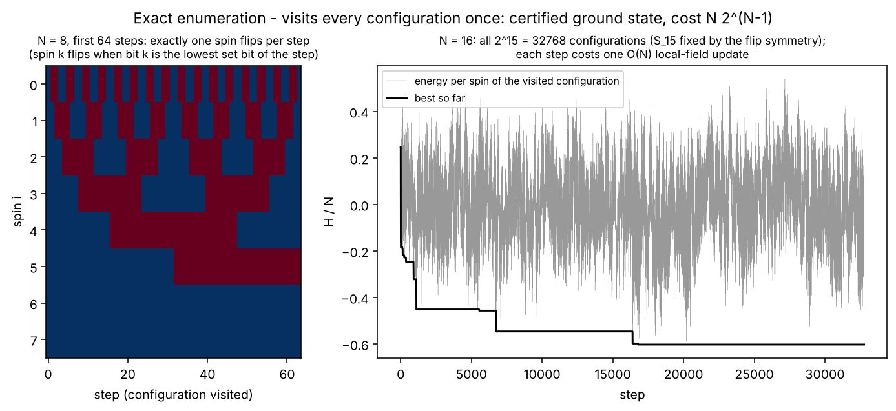

Left: the first 64 configurations for $N=8$; exactly one spin changes per step. Right: the energy of all $2^{15}$ configurations visited for $N=16$, wildly up and down, and the best so far, which ends at the certified ground state.

## 2. Greedy: steepest descent with restarts

**What it does to the spins.** Start from a random configuration. Repeatedly flip **the most unsatisfied agent** (most negative $\lambda_k$, i.e. the largest energy drop $2|\lambda_k|$) until every agent is satisfied. That is a **local minimum**. Repeat from `restarts` random configurations and keep the best.

**How it escapes local minima.** Only by restarting. Each descent ends in the minimum whose **basin** it started in.

**Cost.** One descent takes a few $\times N$ flips (measured: at most 7 flips for $N=14$). Each flip costs $O(N)$ to find the most unsatisfied agent and $O(N)$ to update the fields.

**Code.** `GreedyMultistart(restarts=20|200)`; `_greedy` is also the **polish** step applied after SA, PT, τ-EO, SDP and the annealer reads. `SteepestDescentSolver` in dwave-samplers is the same algorithm.

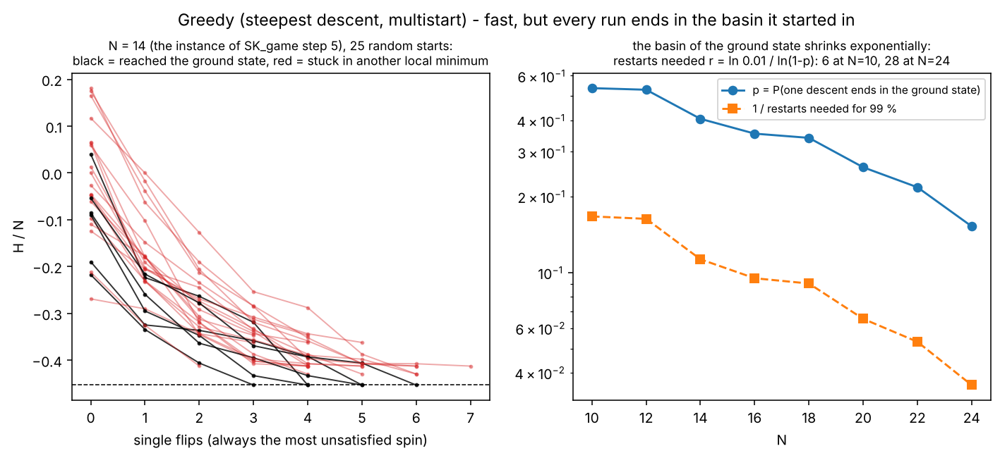

Left: 25 descents on the $N=14$ instance of SK_game step 5. Black: ended in the ground state. Red: stuck in one of the other 7 minima. Right: $p$, the probability that one descent ends in the ground state (exact, 6 instances × 300 starts), falls from 0.52 at $N=10$ to 0.15 at $N=24$. The restarts needed for 99 % confidence are

$$r=\frac{\ln0.01}{\ln(1-p)}:\quad N=10:\ \frac{-4.61}{\ln0.48}=\frac{-4.61}{-0.73}\approx6,\qquad N=24:\ \frac{-4.61}{\ln0.85}=\frac{-4.61}{-0.16}\approx28,$$

and $r$ grows exponentially with $N$, like the number of minima.

## 3. The SK game itself, used as an optimiser

**What it does to the spins.** This is exactly the learning of SK_game step 9 on $W$: every agent plays $S_i=\operatorname{sign}Q_i$, then **all** agents update their incentive at once, $Q_i\leftarrow(1-\alpha)Q_i+\alpha h_i$. An agent changes its decision when its accumulated field changes sign, i.e. when it has been **unsatisfied for long enough**. `beta0` adds noise that is annealed away during the run.

**How it escapes local minima.** It does not. A fixed point has $\lambda_i\ge0$ for all $i$ (SK_game step 10), so the dynamics **freezes** in the first local minimum it reaches. The memory only smooths the path towards it.

**Cost.** $O(N^2)$ per step for $W\,S$; `steps` × `restarts`.

**Code.** `SKGameLearner(alpha=0.05, steps=800|5000, restarts=2|8, beta0=None)`.

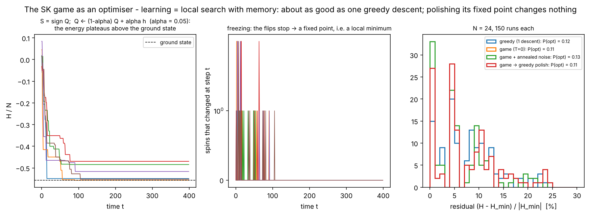

Left: the energy plateaus above the ground state. Middle: the number of agents changing decision per step drops to 0 (**freezing**). Right: 150 runs each at $N=24$. One game run finds the optimum with probability 0.11, one greedy descent 0.12. The annealed-noise variant (0.13) is not significantly better with 150 runs. **Polishing the game's final state with greedy changes nothing** (the red histogram covers the orange one exactly), because it is already a local minimum. In the overview (§9) the game is the weakest solver at every $N$.

## 4. Simulated annealing (SA)

**What it does to the spins.** Pick a random agent $k$ and propose the flip, with $\Delta H=2\lambda_k$:
* **unsatisfied** ($\lambda_k<0$, $\Delta H<0$): always accepted;
* **satisfied** ($\lambda_k>0$): accepted with probability $e^{-\beta\Delta H}=e^{-2\beta\lambda_k}$ (Metropolis).

$N$ proposals make one sweep. The inverse **temperature** $\beta$ rises geometrically from $\beta_0=0.1$ (almost every flip accepted) to $\beta_1=5$ (almost only downhill). The solver returns the best configuration seen, polished by greedy.

**How it escapes local minima.** At high temperature it climbs the **barriers** by accepting satisfied agents' flips. As it cools, the barriers become impassable one after the other, deepest last. With slow enough cooling it ends in a deep minimum. Formally, it reaches the ground state for logarithmic schedules, but these are far too slow in practice.

**Cost.** sweeps × $N$ proposals of $O(1)$ (accepted flips cost $O(N)$).

**Code.** `SimulatedAnnealing(sweeps=300|5000, beta0=0.1, beta1=5, restarts=2|8)`; `dwave_sa` is the C++ version (§8).

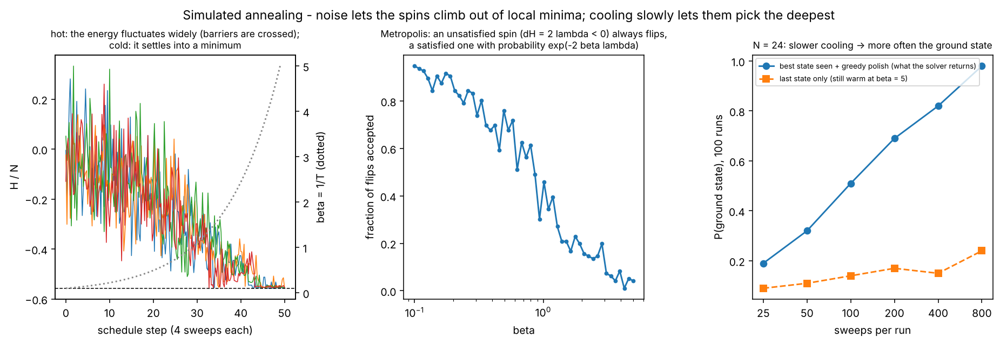

Left: energy during four anneals (β dotted). It fluctuates widely when hot and settles when cold. Middle: the fraction of accepted flips goes from about 0.95 at $\beta=0.1$ to about 0.05 at $\beta=5$. Right: with more sweeps the ground state is found more often, from 0.19 at 25 sweeps to 0.98 at 800 (100 runs each). The dashed curve shows why the solver keeps the *best state seen*: at $\beta=5$ the last state is still warm and only rarely the ground state.

## 5. Parallel tempering (PT, replica exchange)

**What it does to the spins.** Run $R$ copies (**replicas**) of the system at once, at temperatures $\beta_1<\dots<\beta_R$, each doing Metropolis sweeps as in SA. After each sweep, try to swap the configurations of neighbouring temperatures $k,k+1$. The swap is accepted with probability

$$\min\!\big(1,\ e^{(\beta_k-\beta_{k+1})(E_k-E_{k+1})}\big).$$

It is always accepted when the colder temperature receives the lower energy.

**How it escapes local minima.** A replica stuck in a minimum at a cold temperature gets swapped to a hot one, where it melts out of the minimum. It then cools again by later swaps into another basin. Low-energy configurations flow to the cold end. Unlike SA, nothing is ever "frozen for good".

**Cost.** $R$ × sweeps × $N$; `n_replicas=12|24`, `sweeps=300|5000`. It is also the **reference** solver of the campaign above $N=24$ (long runs, `ref_sweeps`).

**Code.** `ParallelTempering(sweeps, n_replicas, beta_min=0.2, beta_max=5)`.

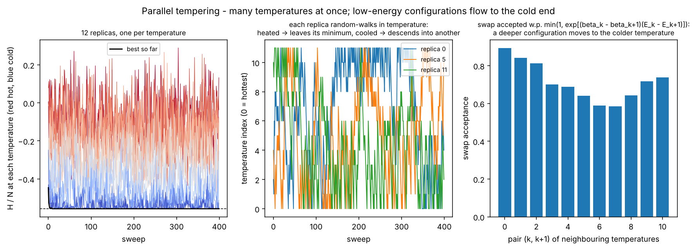

Left: the energy at each of 12 temperatures (red hot, blue cold); the best so far reaches the ground state within about 10 sweeps. Middle: three replicas random-walk across the whole temperature ladder. Right: the swap acceptance is 0.6–0.9 for every pair, so the ladder is well connected.

## 6. τ-extremal optimisation (τ-EO)

**What it does to the spins.** At every step, rank the agents by satisfaction, from rank 1 = most unsatisfied (smallest $\lambda_i$) to rank $N$ = most satisfied. Pick rank $k$ with probability $P(k)\propto k^{-\tau}$ and **flip it unconditionally**, even if that raises the energy. Keep the best configuration seen. There is no temperature and no acceptance test: the "pressure" is always on the least satisfied agents.

**How it escapes local minima.** At a local minimum every $\lambda_i\ge0$, but EO still flips the *least* satisfied agent, the one with the cheapest uphill move, and so keeps moving. The power law sometimes picks well-satisfied agents, which produces large jumps.

**Cost.** $O(N\log N)$ per step (the ranking); `steps_per_spin` × $N$ steps.

**Code.** `ExtremalOptimization(steps_per_spin=60|500, tau=1.3, restarts=1|4)`.

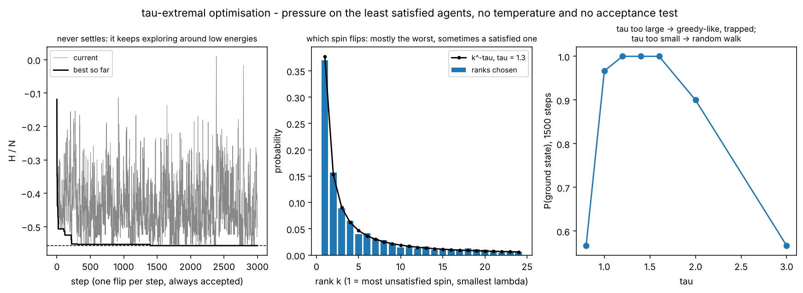

Left: the energy never settles (all moves are accepted), but the best so far reaches the ground state. Middle: the ranks actually picked follow $k^{-1.3}$. Right: the probability of finding the ground state in 1500 steps against τ. τ too small means nearly random flips, τ too large means nearly greedy, trapped. The best values are around $\tau\approx1.2$–$1.6$, consistent with the classical $\tau\approx1+1/\ln N$.

## 7. Tabu search

**What it does to the spins.** At every step, flip the agent with the **smallest $\Delta H=2\lambda_k$ among those not tabu**, even if $\Delta H>0$ (uphill). A flipped agent becomes **tabu** for `tenure` steps: it cannot be flipped back, unless that would give a new best energy (the aspiration rule).

**How it escapes local minima.** Deterministically. At a local minimum it takes the least uphill move, and the tabu list forbids undoing it, so the search is pushed away from the minimum instead of falling back into it.

**Cost.** $O(N)$ per step. dwave's `TabuSampler` runs MST2 multistart tabu (Palubeckis), with tenure $\min(20,\lfloor N/4\rfloor)$, restarting until `timeout` ms per read.

**Code.** `dwave_tabu(num_reads, timeout_ms=20|500)`; `traced.tabu_search` is the plain version shown here.

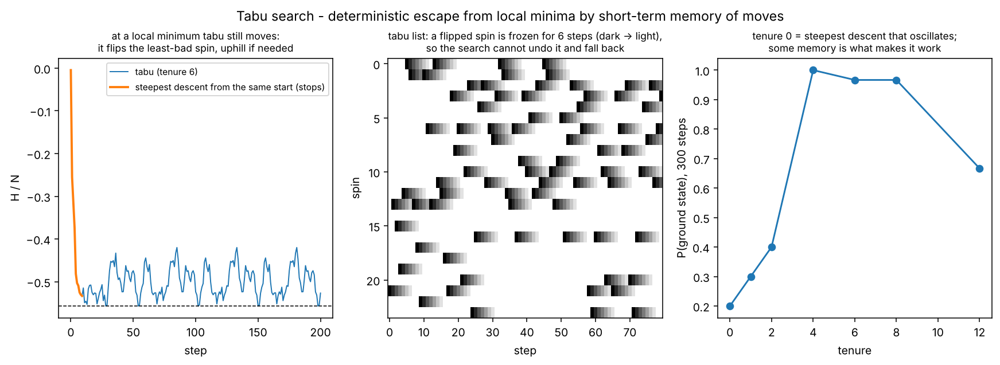

Left: from the same start, steepest descent stops after a few flips. Tabu keeps going and visits the ground state repeatedly (dashed line). Middle: the tabu list; each flipped spin is frozen for 6 steps. Right: with tenure 0 (no memory) it finds the ground state in 20 % of runs, with tenure 4–8 in 97–100 %. Too long a tenure (12) forbids too many moves and the success drops again.

## 8. SDP relaxation + Goemans–Williamson rounding

**What it does to the spins.** Replace each spin $S_i=\pm1$ by a **unit vector** $v_i\in\mathbb R^k$ and minimise the relaxed energy $-\tfrac12\sum_{ij}W_{ij}\,v_i\!\cdot\!v_j$. This is a convex problem (an SDP) once written in terms of $X_{ij}=v_i\cdot v_j$. The code solves it in low rank $k\approx\sqrt{2N}$ (Burer–Monteiro) by the **mixing method**: $v_i\leftarrow$ normalise$(\sum_jW_{ij}v_j)$, i.e. each vector aligns with its **local field**, the vector analogue of a greedy move. Then **round**: draw a random hyperplane with normal $r$ and set $S_i=\operatorname{sign}(v_i\cdot r)$. Agents whose vectors point the same way end on the same side. Polish with greedy.

**How it escapes local minima.** The relaxed problem has no spurious local minima at this rank, so the landscape is smooth. The difficulty moves to the rounding. Bonus: the relaxed optimum is a **certified lower bound** on $H_{\min}$, i.e. an upper bound on the reward, used in the benchmark as `upper_bound_reward` (the certification gap).

**Cost.** iters × $N^2k$ for the mixing method, plus roundings × $N$.

**Code.** `SDPBurerMonteiro(iters=60|400, roundings=50|500)`.

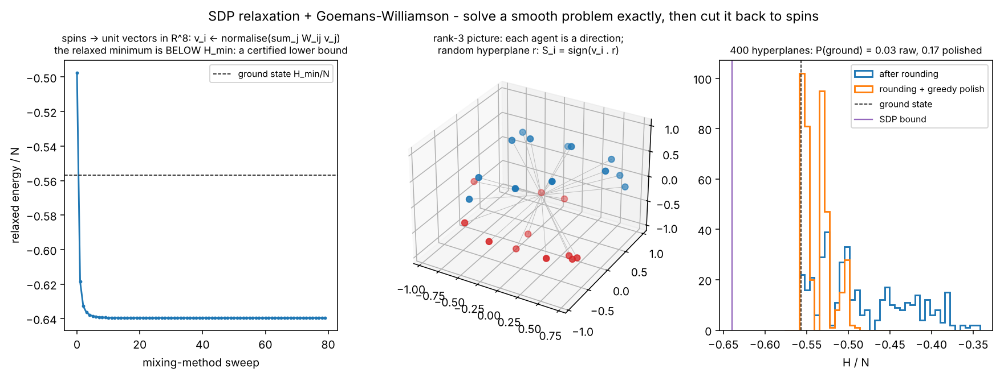

Left: the relaxed energy converges in about 10 sweeps to $-0.64\,N$, **below** the ground state $-0.557\,N$. That bound holds for any algorithm. Middle: the rank-3 picture, with agents as directions and a hyperplane splitting them into $S=\pm1$. Right: 400 roundings. Raw, only 3 % land on the ground state; after greedy polishing, 17 %. The gap between the bound and the optimum (about 15 % here) is what the benchmark reports as `certification_gap`.

## 9. The dimod samplers (dwave-samplers)

They are the same algorithms behind the **dimod** interface that the QPU also uses. The problem is passed as a `BinaryQuadraticModel` in SPIN form with energy exactly $H(S)$ (`PlannerProblem.to_bqm`).

* `SimulatedAnnealingSampler`: SA as in §4, in C++. Sweeps visit the spins **in order** (not at random). β is geometric over a `beta_range` computed from the instance, from "hot enough to flip any spin" to "cold enough to freeze the smallest move".
* `TabuSampler`: §7.
* `SteepestDescentSolver`: §2.

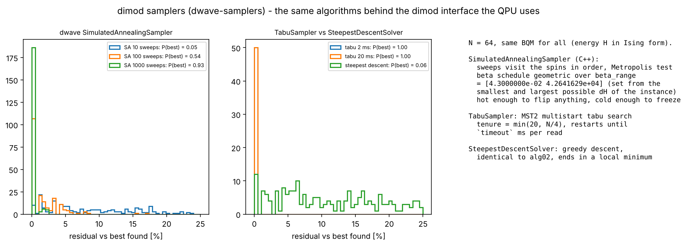

$N=64$, 200 reads each. SA finds the best known energy in 5 % of reads with 10 sweeps, 54 % with 100 sweeps, and 93 % with 1000. Tabu finds it in every read even at 2 ms. Steepest descent finds it in 6 %, and its reads spread over many local minima up to 25 % above.

Overview of all classical solvers on the same instances, run with the project's benchmark (`skgame.optim.benchmark.run_benchmark`, quick budgets):

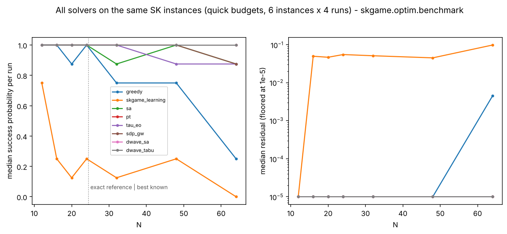

Below $N=24$ the reference is exact; above, it is the best known value. Median success per run with these quick budgets:
* PT, dwave SA and tabu: 1 at every $N$ up to 64;
* SA, τ-EO and SDP + GW: first small dips to 0.875 between $N=32$ and $64$;
* greedy: collapses to 0.25 at $N=64$;
* game learning: the weakest at every $N$ (0 at $N=64$), with a residual of about 5 %, the satisficing gap.

With 6 instances × 4 runs per point, differences of one step (0.125) are within noise. The campaign (`main_simulation.py`, preset `full`) pushes the same comparison to $N=160$ and adds the QPU.

## 10. Quantum annealing (QA)

**What it does to the spins.** The spins become **qubits**. The machine prepares the ground state of a transverse field, $-\sum_i\sigma^x_i$: every configuration superposed with equal amplitude, every agent "undecided". It then slowly changes the Hamiltonian

$$\mathcal H(s)=-A(s)\sum_i\sigma^x_i+B(s)\,H_P,\qquad s=t/T:0\to1,$$

where $H_P$ is the SK energy written with $\sigma^z_i$ in place of $S_i$. $A$ decreases from large to 0 and $B$ increases. At $s=1$ only $H_P$ remains, and **measuring every qubit gives one configuration $S$** (one *read*). The figure uses the idealised schedule $A=1-s$, $B=s$; D-Wave's $A(s)$ and $B(s)$ have the same roles and different shapes.

**How it escapes local minima.** It does not climb barriers: it **tunnels** through them. If $T$ is long compared with $1/\Delta_{\min}^2$, where $\Delta_{\min}$ is the minimum gap between the two lowest levels of $\mathcal H(s)$ (adiabatic theorem), the system stays in the instantaneous ground state and ends in the ground state of $H_P$. Faster anneals leave the system excited, and the reads spread over **local minima**, much like a fast SA.

**On the QPU.** Each spin becomes a **chain** of qubits, because the hardware is not a complete graph. The chains are held together by a strong coupling $-c$ that compresses the SK couplings into a small part of the programmable range ($c\approx1.4$ for SK, logical couplings ≈ 0.05 after scaling at $N=160$). Analogue noise and chain breaks add errors. All of this is explained in [`../embedding_explanation`](../embedding_explanation/README.md) and [`chains_and_tuning.md`](../embedding_explanation/chains_and_tuning.md).

**Cost.** About 15 ms programming + num_reads × (anneal 20 µs + readout ~100 µs + delay ~20 µs) per call. The figure of merit is TTS$_{99}=t_{\rm read}\,\ln0.01/\ln(1-p)$, with $p$ the success probability per read.

**Code.** `QuantumAnnealingSolver` (single solver) and `AnnealBackend` in `skgame/optim/backends.py`: back-ends `qpu:zephyr:clique` (Advantage2) and `qpu:pegasus:clique` (Advantage), plus the `sim:*` stand-ins.

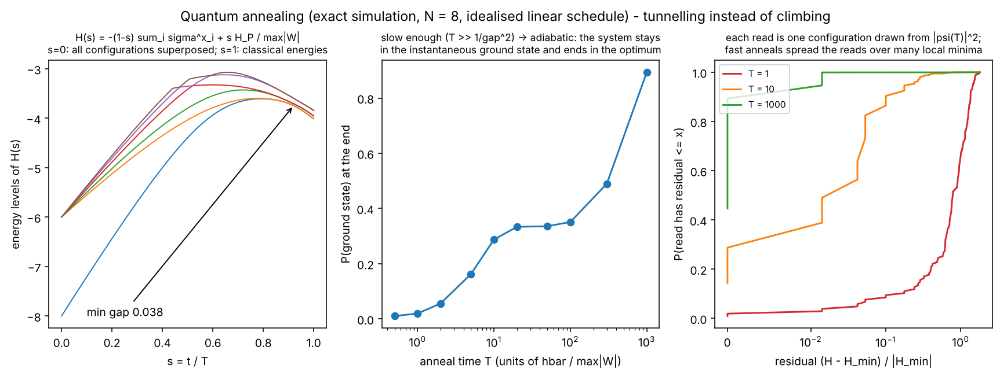

An exact Schrödinger simulation of 8 qubits ($2^8=256$ amplitudes), with no noise and no chains, so an ideal annealer. Left: the lowest levels of $\mathcal H(s)$. The ground state and the first excited state come within $\Delta_{\min}=0.038$ (in units of $\max|W_{ij}|$) late in the anneal, where the transverse field can no longer mix distant configurations. Middle: the probability of ending in the ground state grows with the anneal time $T$: about 0.01 at $T=0.5$, 0.29 at $T=10$, 0.89 at $T=1000$. The adiabatic scale is $1/\Delta_{\min}^2=1/0.038^2\approx700$. Right: the distribution of read energies. Fast anneals ($T=1$) give configurations spread over all energies, slow ones ($T=1000$) are almost all ground states. Real QPU anneals are short in these units and noisy, which is why many reads (and greedy polishing) are used, and why the success probability per read decays with $N$.

---

## Spin state and environment, algorithm by algorithm

`state_and_environment.py` (~10 s) draws each algorithm on the same $N=24$ instance with three rows sharing the time axis:

1. the **spin state**: one row per agent, red when the agent agrees with the ground state $S^\star$, blue when it disagrees. One global sign is chosen per run (so $-S^\star$ also counts as all red), so the ground state is a fully red column;
2. the **environment** the algorithm reacts to;
3. the **energy** $H/N$, with the ground state dashed.

| algorithm | environment row | figure |
|---|---|---|
| greedy | satisfactions $\lambda_i$; black dot = the agent flipped at that step | `figures/se_greedy.png` |
| SK game | incentives $Q_i$, the agents' memory of their rewards | `figures/se_game.png` |
| SA | inverse temperature $\beta(t)$ and the satisfactions | `figures/se_sa.png` |
| PT | overlap with $S^\star$ of the replica at each temperature (spin state of the coldest one) | `figures/se_pt.png` |
| τ-EO | satisfactions + the agent picked by rank | `figures/se_eo.png` |
| tabu | satisfactions + tabu agents (black dots) | `figures/se_tabu.png` |
| SDP + GW | alignment of each vector $v_i$ with the ground-state direction; spins read through a fixed hyperplane | `figures/se_sdp.png` |
| quantum annealing ($N=8$, exact) | schedule $A(s)$, $B(s)$; probability of every classical energy level; spin state = expected agreement (0 = undecided) | `figures/se_qa.png` |

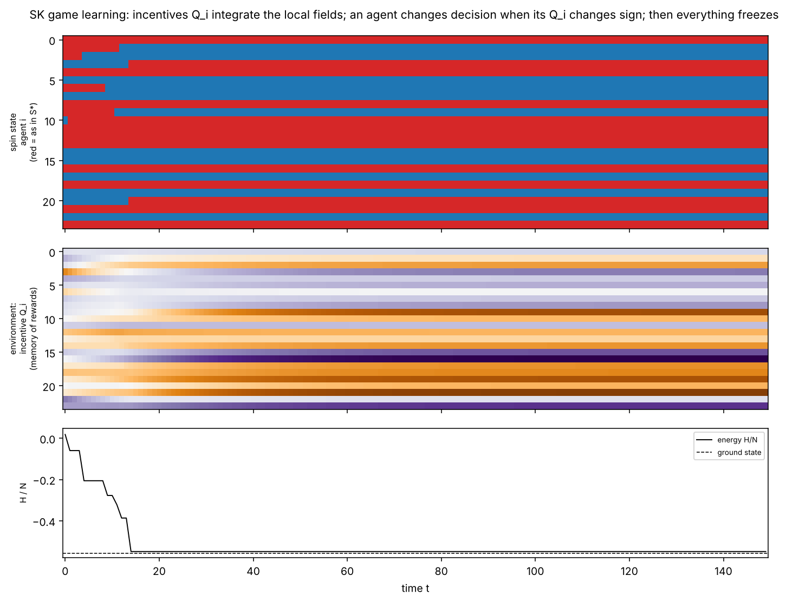

**The game's final state, and greedy's.** Both end at an energy within about 1 % of the ground state (game: $-0.549$ vs $-0.557$ per spin). Yet 11 of 24 agents still disagree with $S^\star$. A local minimum can be **close in energy and far in configuration space**: this is the rugged landscape of SK_game step 5, seen from inside a single run. SA (`se_sa.png`) shows the opposite route. When hot, the spin state is a random mosaic. During cooling, whole groups of agents lock in, and the satisfactions turn uniformly green.

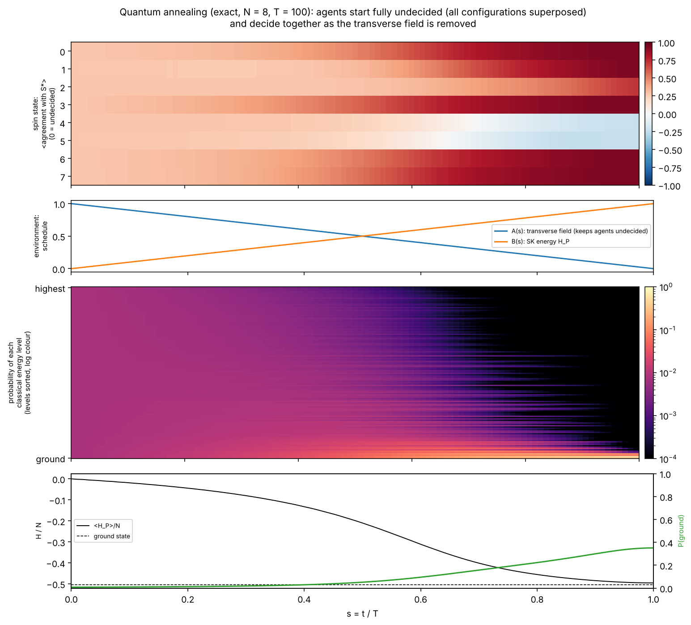

**Quantum annealing.** At $s=0$ every agent is completely undecided (agreement 0): all $2^8$ configurations have equal weight. As the transverse field is removed, the agents decide **together**: the probability migrates from all energy levels down to the lowest ones. Two agents (4 and 5) end on the wrong side with substantial probability, because this anneal ($T=100$) is shorter than the adiabatic scale $1/\Delta_{\min}^2\approx700$, and $P(\text{ground})$ ends at 0.35.

---

## Which algorithm for which regime

Using the regimes of the campaign (`skgame/optim/regimes.py`):
* **`ferro_easy`** ($J_0^{\rm eff}>1$): the landscape has one dominant basin. Even greedy and the game find the optimum, and the annealer should too. This is the control case.
* **`sg_*`, `nonreciprocal_chaos`, `paramagnet`**: the planner's problem is the same SK spin glass in all of them (the regimes only change how the *game* behaves). Exponentially many minima make greedy and the game fail first, then τ-EO and SDP. SA, PT and tabu last longest. The annealer's success per read decays with $N$, with an extra penalty from chains and noise. The campaign measures where each one breaks, and whether Zephyr's shorter chains move that point.
